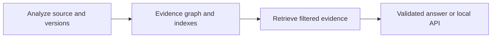

# Openfield

Openfield connects versioned dependency changes to source usages and retrieves the evidence behind each finding.

## Measured result

Benchmark snapshot: 2026-09-24 on Darwin 27.0.0 (arm64/arm), using `BAAI/bge-small-en-v1.5`, `top_k=6`, and 16 frozen development questions. These are development-set measurements, not a claim of statistical superiority.

| Mode | Recall hop 1 | Recall hop 2 | Recall hop 3 | Abstention | Citations | Median ms | P95 ms |
| --- | ---: | ---: | ---: | ---: | ---: | ---: | ---: |
| vector | 1.000 | 0.875 | 0.833 | 1.000 | 1.000 | 0.233 | 0.554 |
| hybrid-graph | 1.000 | 0.875 | 0.833 | 1.000 | 1.000 | 0.359 | 1.010 |

Hybrid graph did not improve aggregate multi-hop recall in this run, so the generated report recommends vector retrieval. See the [generated report](benchmarks/report.md) and [raw per-question results](benchmarks/results.json).

## Deterministic finding and citation

The owned fixture produces this result without importing or executing the target file. Exit status `1` means reviewed findings were present.

```console
$ uv run openfield analyze examples/httpx_028/direct_client.py --package httpx --from 0.27.2 --to 0.28.0 --root . --output /tmp/openfield-report.json
$ jq '.findings[0] | {symbol, keyword, impact, source_url, suggestion}' /tmp/openfield-report.json
{
  "symbol": "httpx.Client",
  "keyword": "proxies",
  "impact": "breaking",
  "source_url": "https://github.com/encode/httpx/releases/tag/0.28.0",
  "suggestion": "Use proxy= for one proxy or mounts= for per-scheme transports."
}
$ uv run openfield ask --database /tmp/openfield-evidence.db --retrieval lexical "What was removed in HTTPX 0.28.0?"
{
  "claims": [{
    "citation_ids": ["httpx-0.28.0-client-arguments-removed"]
  }],
  "abstained": false
}
```

## Architecture



The analyzer emits a reviewed finding. SQLite stores its provenance beside curated release evidence, FTS5 text search, graph edges, and optional exact vectors. Retrieval is bounded by package and version; answering may cite only selected evidence.

## Five-minute quickstart

Python 3.12 or newer and `uv` are required. The semantic model command downloads the optional local model once.

```bash
uv sync --all-groups --all-extras
uv run openfield analyze examples/httpx_028/direct_client.py \
  --package httpx --from 0.27.2 --to 0.28.0 --root . \
  --output /tmp/openfield-report.json
uv run openfield evidence build --database /tmp/openfield-evidence.db \
  --corpus src/openfield/corpus/demo.jsonl \
  --environment examples/httpx_028/environment.json \
  --report /tmp/openfield-report.json
uv run --extra semantic openfield model prepare --cache-dir .cache/openfield-models
uv run --extra semantic openfield evidence embed \
  --database /tmp/openfield-evidence.db --cache-dir .cache/openfield-models
uv run --extra semantic openfield ask --database /tmp/openfield-evidence.db \
  --retrieval hybrid-graph \
  "Why can Starlette 0.36.3 break with HTTPX 0.28.0?"
uv run openfield ask --database /tmp/openfield-evidence.db \
  --retrieval hybrid-graph "Is this entire upgrade safe in production?"
OPENFIELD_DATABASE=/tmp/openfield-evidence.db \
  uv run --extra web uvicorn openfield.api:app_from_environment \
  --factory --host 127.0.0.1 --port 8000
```

The safety question returns `abstained: true`; retrieved relevance is not runtime proof.

## Scope

Supported:

- Python AST analysis for reviewed, directly qualified `httpx.Client(..., proxies=...)` calls across the HTTPX 0.27.2 to 0.28.0 boundary.
- A curated HTTPX and Starlette evidence fixture with source digests and provenance-carrying graph edges.
- Package/version-filtered FTS5, exact vector, reciprocal-rank fusion, and bounded graph expansion.
- Deterministic cited answers, optional validated Anthropic output, and a loopback FastAPI adapter.

Explicitly unsupported:

- General repository walking, dependency-file discovery, arbitrary package packs, runtime inference, wrappers, re-exports, dynamic imports, and `**kwargs` analysis.
- Automated web crawling, LLM-authored executable rules, ANN/vector databases, Neo4j, hosted deployment, patch generation, or CI/PR integration.
- Claims of production scale, complete upgrade safety, broad ecosystem coverage, user adoption, or statistical superiority.

## Evaluation

The frozen [question set](evals/questions.jsonl) has four cases at each hop count from zero through three. The same 16 cases run through vector and hybrid-graph retrieval at `top_k=6`; the evaluator preserves 32 raw runs before separate per-mode summaries. It measures required-evidence recall, abstention, whether every citation was selected, and warm retrieval latency. Citation validity here means citation selection, not semantic entailment of generated prose. The benchmark uses no LLM judge and records model/API cost as zero.

Reproduce it after the quickstart:

```bash
uv run --extra semantic openfield eval \
  --database /tmp/openfield-evidence.db --questions evals/questions.jsonl \
  --modes vector hybrid-graph --top-k 6 \
  --output /tmp/openfield-results.json --report /tmp/openfield-report.md
```

One visible failure is `three-direct-and-transitive`: both modes abstained, vector retrieved one of three required records, and hybrid graph retrieved two. On `three-remediation-options`, vector retrieved all three required records while graph fusion displaced one. Those offsets explain why hybrid graph tied rather than improved aggregate multi-hop recall.

## Privacy and network behavior

Analysis, evidence building, lexical retrieval, deterministic answering, evaluation over prepared vectors, and the core wheel need no API key. Target source is parsed, never executed. `model prepare` is the only required model-network step and downloads from Hugging Face into the selected cache.

Anthropic generation is optional and requires `--generate`, `--confirm-cloud`, `--model`, and an `ANTHROPIC_API_KEY`; only the question and selected evidence IDs, text, and source URLs are sent. The API rejects cloud generation unless the server starts with `OPENFIELD_ALLOW_CLOUD=true`. The documented server binds to `127.0.0.1`.

## Design decisions

| Decision | Why this slice uses it | Upgrade only when |
| --- | --- | --- |
| SQLite instead of Neo4j | One file holds provenance, FTS5, edges, and exact vectors for a 14-chunk corpus. | Graph volume or concurrent workloads exceed measured SQLite limits. |
| Exact search instead of ANN | Exhaustive cosine scoring is inspectable and cheap at this corpus size. | Benchmarks show exact scanning misses a latency target at a larger corpus. |
| Deterministic routing instead of a model router | Routing, fallbacks, and costs stay reproducible and offline. | A labeled routing benchmark shows a model improves retrieval enough to justify variance and cost. |

## What did not work

- Hybrid graph retrieval tied vector recall at every aggregate hop level and was slower in this single run; it is not presented as superior.
- The broad `three-direct-and-transitive` question caused deterministic abstention in both modes because the selected evidence did not support enough question terms.
- Graph fusion helped that question retrieve a second required record but displaced required evidence on another three-hop case, leaving total multi-hop recall unchanged.
- Retrieval relevance alone cannot establish runtime safety, arbitrary installed versions, or production incident counts; those questions deliberately abstain.

## Claims and evidence

| Claim | Artifact | Verification | Limitation |
| --- | --- | --- | --- |
| HTTPX direct usage detection | [Expected report](examples/httpx_028/expected-report.json) + analyzer test | `uv run pytest tests/test_analyze.py -v` | Direct qualified calls only |
| Versioned evidence graph | SQLite fixture + path test | `uv run pytest tests/test_evidence.py -v` | Curated demo corpus |
| Vector vs hybrid-graph comparison | [Benchmark results](benchmarks/results.json) | `uv run --extra semantic openfield eval ...` | 16 development questions |
| Citation validation | Answering tests | `uv run pytest tests/test_answering.py::test_invented_citation_falls_back_to_deterministic_answer -v` | Supplied evidence only |
| Offline core | Import and no-network tests | Core wheel smoke test in the release checks below | Model/API features are opt-in |

## 90-second interview narrative

1. The problem is not upgrading a package; it is finding which documented changes matter to this code.
2. Show the deterministic `proxies` finding, source span, migration, and official HTTPX release citation.
3. Ask why Starlette 0.36.3 can break with HTTPX 0.28.0, then inspect the retrieved Starlette-to-HTTPX evidence path.
4. Show the frozen benchmark: both modes reached 1.000/0.875/0.833 recall at hops one/two/three, so graph retrieval did not win.
5. Ask whether the whole upgrade is safe and show the correct abstention rather than an invented guarantee.
6. Close with the trade-off: exact vector retrieval was faster here; the multi-hop graph both recovered and displaced evidence, so the simpler mode remains the measured recommendation.

## Release checks

```bash
uv run pytest -q
uv run ruff check .
uv run ruff format --check .
uv build
```
