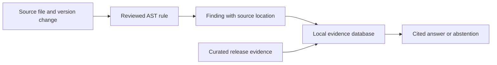

# Openfield

Openfield shows you where a dependency upgrade touches your Python code and explains the relevant change with citations.

Release notes tell you what changed in a package. They usually cannot tell you whether your application still uses the removed API, which source line is affected, or whether a transitive dependency is involved. Openfield connects those pieces: it checks source code against reviewed version rules, stores the supporting evidence locally, and answers follow-up questions without making claims the evidence cannot support.

Today, Openfield covers one complete upgrade path: HTTPX 0.27.2 to 0.28.0, where the `proxies` argument was removed from `httpx.Client`. It also includes the related Starlette `TestClient` compatibility evidence. Support is deliberately narrow; the complete boundaries are listed under [Current support](#current-support).

## How it works



1. `openfield analyze` parses the target file without importing or executing it.
2. A version-aware rule checks for a documented breaking change.
3. `openfield evidence build` stores the finding, dependency environment, and curated release evidence in SQLite.
4. `openfield ask` retrieves package- and version-filtered evidence and returns cited claims. If the evidence is insufficient, it abstains.

## Quickstart

Openfield requires Python 3.12 or newer and [`uv`](https://docs.astral.sh/uv/).

Install the project dependencies from the repository root:

```bash
uv sync --all-groups --all-extras
```

Create a temporary workspace for the demo:

```bash
OPENFIELD_DEMO_DIR="$(mktemp -d)"
```

### 1. Analyze a dependency upgrade

```bash
uv run openfield analyze examples/httpx_028/direct_client.py \
  --package httpx \
  --from 0.27.2 \
  --to 0.28.0 \
  --root . \
  --output "$OPENFIELD_DEMO_DIR/report.json"
```

The included example contains this call:

```python
import httpx

client = httpx.Client(proxies="http://localhost:8080")
```

The generated report identifies `httpx.Client`, the removed `proxies` argument, its source location, the breaking-change impact, and the recommended replacement:

```json
{
  "symbol": "httpx.Client",
  "keyword": "proxies",
  "impact": "breaking",
  "source_url": "https://github.com/encode/httpx/releases/tag/0.28.0",
  "suggestion": "Use proxy= for one proxy or mounts= for per-scheme transports."
}
```

`analyze` uses exit status `1` when affected usage is found, `0` when no reviewed finding is found, and `2` when the command cannot complete. The non-zero finding status makes the command usable in scripts and CI without treating “no finding” and “analysis failed” as the same result.

### 2. Build the local evidence database

```bash
uv run openfield evidence build \
  --database "$OPENFIELD_DEMO_DIR/evidence.db" \
  --corpus src/openfield/corpus/demo.jsonl \
  --environment examples/httpx_028/environment.json \
  --report "$OPENFIELD_DEMO_DIR/report.json"
```

This creates a SQLite database containing the analyzer finding, the owned dependency environment, curated HTTPX and Starlette evidence, provenance, FTS5 search data, and graph edges.

### 3. Ask a cited question

Lexical retrieval works locally without downloading a model:

```bash
uv run openfield ask \
  --database "$OPENFIELD_DEMO_DIR/evidence.db" \
  --retrieval lexical \
  "What was removed in HTTPX 0.28.0?"
```

One of the deterministic claims in the response is:

```json
{
  "claims": [
    {
      "text": "HTTPX 0.28.0 removed the previously deprecated proxies and app client arguments.",
      "citation_ids": ["httpx-0.28.0-client-arguments-removed"]
    }
  ],
  "abstained": false,
  "retrieval_mode": "lexical",
  "model": null
}
```

The actual response may include additional supported claims from the Starlette compatibility evidence.

## Semantic and graph-assisted retrieval

Openfield can also embed the evidence locally with `BAAI/bge-small-en-v1.5`. Model preparation is a one-time download from Hugging Face:

```bash
uv run --extra semantic openfield model prepare \
  --cache-dir .cache/openfield-models

uv run --extra semantic openfield evidence embed \
  --database "$OPENFIELD_DEMO_DIR/evidence.db" \
  --cache-dir .cache/openfield-models
```

Ask a question that crosses the Starlette-to-HTTPX evidence path:

```bash
uv run --extra semantic openfield ask \
  --database "$OPENFIELD_DEMO_DIR/evidence.db" \
  --retrieval hybrid-graph \
  "Why can Starlette 0.36.3 break with HTTPX 0.28.0?"
```

Available retrieval modes:

| Mode | What it does |
| --- | --- |
| `lexical` | Searches package- and version-filtered evidence with SQLite FTS5. |
| `vector` | Runs exact cosine search over local FastEmbed vectors. |
| `hybrid-graph` | Fuses lexical and vector rankings, then follows related evidence through bounded graph expansion. |

Openfield does not equate relevant evidence with proof. For example:

```bash
uv run openfield ask \
  --database "$OPENFIELD_DEMO_DIR/evidence.db" \
  --retrieval hybrid-graph \
  "Is this entire upgrade safe in production?"
```

This returns `"abstained": true` because release evidence cannot establish the runtime safety of an arbitrary application.

## HTTP API

Start the local API with an existing evidence database:

```bash
OPENFIELD_DATABASE="$OPENFIELD_DEMO_DIR/evidence.db" \
  uv run --extra web uvicorn openfield.api:app_from_environment \
  --factory --host 127.0.0.1 --port 8000
```

Check the server:

```bash
curl -s http://127.0.0.1:8000/healthz
```

Ask a question:

```bash
curl -s http://127.0.0.1:8000/ask \
  -H 'Content-Type: application/json' \
  -d '{
    "question": "What was removed in HTTPX 0.28.0?",
    "retrieval": "lexical",
    "packages": ["httpx"],
    "versions": ["0.28.0"],
    "generate": false
  }'
```

The API rejects unknown request fields, requires package and version filters, and returns HTTP 403 for cloud generation unless the server is explicitly started with `OPENFIELD_ALLOW_CLOUD=true`.

## Optional generated explanations

Deterministic answers are the default. Anthropic-generated wording is opt-in and requires the `ai` extra, an API key, an explicit model, and confirmation that selected evidence will be sent to the provider:

```bash
export ANTHROPIC_API_KEY="..."

uv run --extra ai openfield ask \
  --database "$OPENFIELD_DEMO_DIR/evidence.db" \
  --retrieval lexical \
  --generate \
  --confirm-cloud \
  --model "YOUR_MODEL_NAME" \
  "What was removed in HTTPX 0.28.0?"
```

Only the question and selected evidence IDs, text, and source URLs are sent. Openfield validates the returned JSON and citations. If the provider is unavailable or the response cites evidence that was not selected, Openfield returns the deterministic answer instead.

For API generation, start the server with `OPENFIELD_ALLOW_CLOUD=true` and include both `"generate": true` and `"model": "..."` in the request. Cloud access is disabled by default.

## Current support

Openfield currently supports:

- Python source parsed with the standard-library AST.
- Direct, qualified `httpx.Client(..., proxies=...)` calls.
- The HTTPX 0.27.2 to 0.28.0 version boundary.
- A curated HTTPX and Starlette evidence corpus.
- SQLite FTS5, exact vector retrieval, reciprocal-rank fusion, and bounded graph expansion.
- Deterministic cited answers, strict abstention, optional validated Anthropic output, and a local FastAPI service.

It does not yet support:

- Walking an entire repository or discovering dependency files automatically.
- Other package rule packs or arbitrary version changes.
- Wrappers, re-exports, dynamic imports, runtime inference, or `**kwargs` analysis.
- Automated web crawling, generated executable rules, patch generation, or CI/PR integration.
- Hosted deployment, ANN indexes, external vector databases, or Neo4j.

The analyzer reports only what its reviewed rules establish. It does not claim that an upgrade is completely safe or predict production behavior.

## Privacy and network access

- Target source is read and parsed; it is never imported or executed.
- Analysis, evidence ingestion, lexical retrieval, and deterministic answering work locally without an API key.
- Semantic retrieval uses a locally cached embedding model after the initial Hugging Face download.
- Anthropic access is optional and requires explicit CLI or server configuration.
- The documented API listens only on `127.0.0.1`.

## Evaluation

The repository includes a frozen 16-question development set comparing exact vector retrieval with hybrid graph-assisted retrieval. In the checked-in run, both modes reached the same aggregate recall at one, two, and three hops; vector retrieval was faster. The graph path is therefore available for inspection and experimentation, not presented as automatically better.

See the [benchmark report](benchmarks/report.md), [raw results](benchmarks/results.json), and [question set](evals/questions.jsonl). These measurements describe the included development corpus, not production performance.

To reproduce the benchmark after embedding the evidence database:

```bash
uv run --extra semantic openfield eval \
  --database "$OPENFIELD_DEMO_DIR/evidence.db" \
  --questions evals/questions.jsonl \
  --modes vector hybrid-graph \
  --top-k 6 \
  --output "$OPENFIELD_DEMO_DIR/results.json" \
  --report "$OPENFIELD_DEMO_DIR/benchmark.md"
```

## Development

Run the test, lint, formatting, and package checks with:

```bash
uv run pytest -q
uv run ruff check .
uv run ruff format --check .
uv build
```
