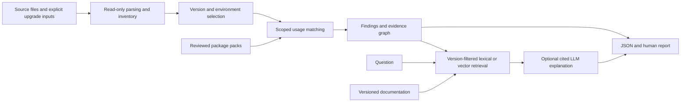

# Openfield — product and implementation plan

**Created:** 17 September 2026  
**Status:** researched plan; implementation has not started  
**Intended repository:** `/Users/rishabh/Desktop/work/works/openfield`  
**Owner:** Rishabh  
**Product:** an open-source Python dependency-upgrade impact assistant

> Openfield helps a developer understand which documented dependency changes may affect their code, where the relevant usages are, and what evidence supports each finding.

This is a sequence of small releases, not a commitment to build the entire backlog before showing anyone. Start with **C0.01**, then complete the first working HTTPX example in **C1**. Every slice has dependencies, a concrete output, acceptance checks, and a learning objective. Future features have explicit entry conditions.

All commands and interfaces below are **proposed contracts**, not commands that already work. Effort estimates are planning ranges, not measured delivery times. Research reflects documentation available on the creation date; verify and lock exact dependency versions when implementing the relevant slice.

## Contents

1. [Product outcome and boundaries](#1-product-outcome-and-boundaries)
2. [Users, discovery, and priorities](#2-users-discovery-and-priorities)
3. [Package coverage and release scope](#3-package-coverage-and-release-scope)
4. [Technology decisions](#4-technology-decisions)
5. [Inputs, outputs, and user experience](#5-inputs-outputs-and-user-experience)
6. [Analysis, evidence, and graph design](#6-analysis-evidence-and-graph-design)
7. [ML, retrieval, and LLM design](#7-ml-retrieval-and-llm-design)
8. [Evaluation and quality gates](#8-evaluation-and-quality-gates)
9. [Distribution and deployment](#9-distribution-and-deployment)
10. [Security, privacy, and legal boundaries](#10-security-privacy-and-legal-boundaries)
11. [Milestones and working method](#11-milestones-and-working-method)
12. [Build chunks and slices](#12-build-chunks-and-slices)
13. [Future improvements and their triggers](#13-future-improvements-and-their-triggers)
14. [Launch, maintenance, and portfolio evidence](#14-launch-maintenance-and-portfolio-evidence)
15. [Decision log and risks](#15-decision-log-and-risks)
16. [Research sources and skill usage](#16-research-sources-and-skill-usage)

## 1. Product outcome and boundaries

### 1.1 The problem

A dependency-update tool can propose a new version. A developer still needs to read release notes, identify relevant API changes, find affected code, and decide what to test. Openfield targets that investigation step.

**Primary job:** “When reviewing a Python dependency upgrade, help me locate the documented changes that matter to this repository so I can make a better migration and testing decision.”

**First useful result:** a report connecting the removal of HTTPX's `proxies` argument to an actual `httpx.Client(proxies=...)` call, with the source file, line, upgrade versions, release-note citation, and a bounded migration suggestion. HTTPX 0.28.0 is a deliberately historical, reproducible example. It is not a claim about the newest release. [R1]

### 1.2 What will make it substantial

- Real code analysis with explicit limits, rather than sending a whole repository to a model.
- Version-aware evidence linking dependencies, documented changes, symbols, and source usages.
- A useful offline path with no API key.
- Measured comparisons between rules, lexical retrieval, vector retrieval, and graph-assisted retrieval.
- Reproducible reports, a published coverage matrix, and understandable failure modes.
- Installation and CI integration that someone outside the project can use.

The engineering value comes from trustworthy analysis and evaluation. A large stack, a chat window, or an autonomous-agent label does not establish that value.

### 1.3 Relationship to the six-project guide

This implements the guide's first project's graph-plus-vector retrieval learning objectives in a developer-tool setting. It includes ingestion, entity resolution, graph traversal, retrieval, cited answers, an evaluation set, and cost/latency reporting.

The guide's suggested Neo4j, pgvector, and orchestration libraries are reference choices. Openfield starts with **SQLite graph tables and local vector search**, which teach the same relationships with fewer services. A graph database becomes a later comparison only if a measured need appears.

### 1.4 Explicit non-goals through the first AI release

- Proving an upgrade safe, resolving every dependency conflict, or replacing the project's tests.
- Installing, importing, or executing the repository under analysis.
- Automatically modifying source code, upgrading dependencies, opening pull requests, or merging changes.
- Analyzing arbitrary languages, dynamic Python behavior, compiled extensions, or every Python package.
- A vulnerability scanner, license-compliance certification tool, or complete substitute for dependency-update bots.
- A hosted service that accepts arbitrary private repositories.

## 2. Users, discovery, and priorities

### 2.1 Initial users

| User | Current task | Desired benefit | Initial surface |
|---|---|---|---|
| Python backend developer | Review an upgrade in a service | Find likely code changes and tests to inspect | Local CLI/report |
| Small OSS maintainer | Triage dependency-update PRs | Separate relevant changes from release-note noise | CI artifact |
| Engineering interviewer | Assess technical judgment | Inspect evidence, implementation, and evaluation | Public repo and demo |

Begin with one repository and one developer. Team administration, billing, and enterprise integrations are outside the initial product.

### 2.2 Discovery without delaying the first build

Treat these as hypotheses, not findings:

| Opportunity | Two inexpensive experiments | Evidence to record |
|---|---|---|
| Developers lose time mapping release notes to code | Observe one real upgrade review; compare a hand-written Openfield report with the current workflow | Investigation steps, elapsed time, missing information |
| Developers distrust AI upgrade advice | Show the same finding with and without citations; ask a developer to verify one correct and one incorrect finding | Verification success, rejected claims, preferred evidence |
| Existing upgrade workflows lack a compact impact summary | Share a local report prototype; try an artifact on one consenting maintainer's update PR | Whether they use the result and return for another upgrade |

Aim for three conversations or observed reviews before broadening the package list. Ask about a recent upgrade, the workaround used, and what would make a report actionable. Do not lead with “Would you use my AI tool?”

The project can proceed as a learning project if external users are unavailable. Label demand as unvalidated and avoid building hosting or team features to compensate. Any interviews, outreach, issue comments, or PRs require a deliberate owner action; this plan does not authorize automated outreach.

### 2.3 Priorities

**Must have:** exact upgrade inputs, bounded static analysis, reviewed rules, citations, coverage/unknowns, reproducible output, offline behavior, and a clear installation path.

**Should have after the first CLI:** manifest/lockfile inventory, evidence graph, local semantic retrieval, structured explanations, evaluations, CI artifacts, and more package packs.

**Could have after validation:** local web viewer, static public demo, user-defined rules, saved report comparison, and a dependency-update bot integration.

**Later only with evidence:** automated patches, sandboxed verification, a GitHub App, multi-tenant hosting, a dedicated graph/vector database, and other languages.

Avoid numeric RICE scoring before actual reach and usage data exist. Reprioritize using observed task frequency, severity, maintenance cost, and implementation effort.

### 2.4 Product success targets

These are proposed targets, not achievements:

- A new user can run the included example and understand its first finding within ten minutes.
- Three external developers can verify a finding without the author explaining it live.
- At least two pilot users return for a second analysis before investing in a hosted service.
- For a small observed sample, compare upgrade-investigation time with and without Openfield; publish sample size and task differences.
- Track false-positive reports and unsupported cases before tracking stars.

GitHub popularity is uncertain. Useful reports, contribution-friendly package packs, transparent benchmarks, and low setup friction are the controllable inputs.

## 3. Package coverage and release scope

### 3.1 Coverage means specific rules and versions

Do not say “supports Pydantic” without qualifying what that means. Publish a matrix containing package, tested source/target versions, rule families, supported syntax, source freshness, positive/negative fixtures, and known gaps.

Use these coverage states:

1. **Inventory only:** recognizes the package/version; makes no API impact claim.
2. **Documented changes:** has reviewed change records for a version interval.
3. **Usage matched:** can connect selected changes to supported source patterns.
4. **Fixture verified:** demonstrates the selected behavior before/after in an isolated, owned fixture.

States apply per rule/version interval, not to the entire library. Runtime fixture verification is a maintainer activity on trusted examples; a normal Openfield scan never runs user code.

### 3.2 Expansion order

| Stage | Packages | Initial capability | What remains out of scope |
|---|---|---|---|
| First demo | HTTPX | Selected removed keyword arguments on directly resolved calls; 0.27.2 → 0.28.0 fixture | Wrappers, inferred client instances, arbitrary behavior changes |
| First reusable release | HTTPX | Reviewed historical rules plus one currently relevant interval selected during implementation | A claim to cover every HTTPX release |
| AI portfolio milestone | HTTPX + Pydantic | HTTPX evidence queries; selected Pydantic import/decorator changes and migration explanations | General model/type inference and all V1→V2 semantics |
| Broader beta | Add FastAPI + Starlette | Selected documented API changes and dependency compatibility relationships | Full framework runtime analysis |
| Expanded v1 candidate | Add Requests + SQLAlchemy | Selected changelog rules; SQLAlchemy direct-call migration cases | Treating every ORM instance method as a known type |
| Later candidates | NumPy, pandas, urllib3, aiohttp, Django | Choose one from actual user requests and available evidence | Promising all of them now |

That is a planned progression to **six packages**, not six complete migration engines. A package that has no useful direct-call rule can remain inventory/documentation-only until a defensible rule exists.

Pydantic V1→V2 and SQLAlchemy 1.4→2.0 are useful historical benchmarks with official migration material. They must not be the sole evidence of present-day usefulness. Add at least one recent, reviewed upgrade interval before promoting the tool as current. Distinguish deprecated APIs from removed ones; some historical methods continue to work with warnings. [R2][R3]

### 3.3 Rule-pack contract

Use JSON files validated by the existing schema library. No executable third-party plugin loading initially. A pack contains:

- Package identity, import roots, pack version, schema version, and maintainer.
- Explicit source/target applicability, introduction/deprecation/removal facts when known.
- Symbol identity and supported match pattern, such as a removed keyword on a direct callable.
- Change kind, impact category, factual summary, and suggested verification step.
- Source URL, source version/heading, retrieved date, content digest, and short supporting excerpt where permitted.
- Human review status, test fixture identifiers, and stated limitations.

Adding a package should normally mean adding reviewed data and fixtures. Add a new matcher only when a second real case needs it. Do not build a rule language or plugin SDK in advance.

## 4. Technology decisions

### 4.1 Recommended stack

| Layer | Decision | Why / boundary |
|---|---|---|
| Language | Python 3.13 for development; initial core floor 3.12 | Supported versions with modern stdlib. Test 3.12–3.14 core compatibility before advertising it; model extras have a separate matrix. [R4] |
| Project/dependency management | `uv`, committed `uv.lock` | Reproducible development and simple contributor setup. Exact versions are locked at implementation. |
| Build backend | `uv_build` | Sufficient for a conventional pure-Python package; verify included rule data in built wheels. [R5] |
| CLI | `argparse` | Standard library covers this command surface. No CLI framework required. |
| Source analysis | `ast`, `tokenize`, `pathlib` | Parse source without importing it; respect source encodings; bounded static analysis. |
| Versions and lockfiles | `packaging` | Use PEP 440 requirements, versions, markers, normalization, and `packaging.pylock`; do not implement version semantics manually. [R6][R7] |
| Data validation | Pydantic 2 | Shared report, pack, and structured-LLM schemas. Use strict boundary validation. |
| Ignore patterns | `pathspec`, added with ignore support | Reuse established gitignore-style matching; do not hand-roll its edge cases. |
| Persistence and graph | stdlib `sqlite3` | One local database, typed tables and edge relationships, explicit SQL, foreign keys. No ORM initially. |
| Lexical retrieval | SQLite FTS5 | Search exact API names and documentation text; check extension availability at startup. [R8] |
| Embeddings | Optional `fastembed` + explicit `numpy` dependency | Local CPU embeddings and exact cosine search; no Torch/GPU requirement for the chosen path. [R9] |
| Embedding model | `BAAI/bge-small-en-v1.5` first candidate | English, 384 dimensions, 512-token input limit; evaluate on API documentation. Model card lists MIT. [R10] |
| LLM | Optional official `anthropic` Python SDK | One provider and one request path initially, structured output into Pydantic schemas. [R11] |
| Documentation fetch | Optional `httpx` | Explicit update operation with timeouts, source restrictions, size limits, and conditional requests. |
| HTML report | Optional Jinja2 with autoescape | Self-contained local report; no frontend build tool. |
| Local service | Optional FastAPI + Uvicorn, later | Only for interactive report querying that static HTML cannot provide. [R12] |
| Testing | `pytest` dev dependency | End-to-end regression cases, boundary cases, and fixtures justify one small test runner. |
| Formatting/lint | Ruff | One tool for both; add type checking only once useful typed boundaries exist. [R13] |
| Distribution | PyPI wheel/sdist, GitHub Releases, GitHub Actions | A developer tool should be easy to install and use in CI. |
| Optional hosting | Static demo first; Render Docker service if needed | Canned public examples, single process, no arbitrary repo ingestion. |

These are **Openfield's own dependencies**. They are separate from the libraries Openfield analyzes. Openfield using Pydantic 2 does not require installing a scanned project's Pydantic version.

### 4.2 Dependency groups and version policy

Begin with runtime `packaging` and Pydantic; add `pathspec` only when its slice lands. Keep `pytest` and Ruff in a development group. Introduce extras when implemented:

- `semantic`: FastEmbed and NumPy.
- `ai`: Anthropic SDK.
- `fetch`: HTTPX for explicit evidence refresh.
- `html`: Jinja2.
- `web`: FastAPI, Uvicorn, and the HTML rendering dependency.

Do not create empty extras now. Core CLI imports must not load optional ML packages or initialize downloads. If a user requests an unavailable extra, show the precise install instruction and retain deterministic output.

Choose tested stable releases during C1.01, commit the resolved lock, and record runtime versions in reports. Published dependency ranges should reflect tested compatibility, while the development lock pins exact versions. Do not pin every consumer to one full transitive environment. `packaging.pylock` requires a version containing that API (documented from 26.0); lockfile selection APIs must also be checked against the selected release. [R7]

The optional ONNX stack needs a clean install and one real embedding on macOS ARM64 and Linux x86-64. If Python 3.13 wheels fail, use a documented Python 3.12 semantic environment temporarily; do not solve this by silently building a heavy native stack. Support Windows or newer runtimes only after testing them.

### 4.3 Intentionally absent

No LangChain/LlamaIndex, agent graph framework, Redis, Celery, Kafka, Kubernetes, Terraform, React, PostgreSQL, Neo4j, managed vector database, or model training in the first release. The application has one local workflow and can use direct function calls.

Preserve future options through versioned data formats, explicit inputs/outputs, and provenance. Do not create one-implementation interfaces, provider factories, or an abstract storage layer “for later.”

## 5. Inputs, outputs, and user experience

### 5.1 Proposed commands

Only implement a command when its slice is reached. Distribution name availability is unverified; `openfield` is the chosen repository and CLI name.

```text
openfield analyze ./demo --package httpx --from 0.27.2 --to 0.28.0
openfield analyze ./demo --package httpx --from 0.27.2 --to 0.28.0 --format json --output report.json
openfield analyze ./repo --before before.pylock.toml --after after.pylock.toml --environment environment.json
openfield report report.json --format html --output report.html
openfield packs list
openfield doctor
openfield model prepare
openfield evidence fetch --package httpx
openfield ask --report report.json --retrieval hybrid-graph "Why is this call affected?"
```

`analyze` is offline by default, including in CI. It neither resolves new versions nor invokes `pip`, `uv sync`, build hooks, Git hooks, or the target application's tests. Fetching evidence, downloading an embedding model, and calling a cloud model are separate explicit actions.

For a single-package override, show that the source/target versions were **user supplied**, not verified installed versions. When an override conflicts with imported inventory, require an explicit choice or reject the inconsistent request.

### 5.2 Input support ladder

1. **Exact source and target versions:** easiest first vertical slice.
2. **`pyproject.toml` declarations and simple pinned requirements:** inventory only where exact versions cannot be established. Never equate `>=1.0` with an installed version.
3. **Before/after `pylock.toml`:** reuse `packaging.pylock` validation, select the declared environment, and compare version/source identities. Optional audit dependency edges may be absent; do not invent them. [R7][R14]
4. **User-provided `uv workspace metadata` JSON:** richer dependency relationships, behind a versioned experimental importer because the current schema is preview. Prefer the documented export over directly parsing unstable `uv.lock` internals. [R15]
5. **Later:** Poetry/PDM adapters or other exports only when users request them.

An `environment.json` records Python full version/implementation, platform and architecture marker values, selected extras/groups, and provenance. If environment selection remains ambiguous, report alternatives/unknowns instead of choosing the machine running Openfield silently.

For uv users, document an explicit user-run export from the existing lock using the pinned uv version and non-mutating flags. `uv export --format pylock.toml --frozen` is a starting point to validate; group/extra/environment semantics require fixtures. Never automatically run a preview metadata command against an untrusted repo. The metadata command's `--sync` can install packages and is prohibited in the scan path. [R15][R16]

For requirements files, initially accept documented simple forms through `packaging.Requirement`; report unsupported `-r`, `-c`, editable, URL, and index directives. Implement recursive includes later with path confinement and cycle detection. Do not claim compatibility with the complete pip requirements format.

### 5.3 Report contract

Each report includes:

- Schema/tool/pack versions; source snapshot digest; input and environment provenance.
- Requested upgrades and whether each is resolved, ambiguous, unsupported, or missing.
- Findings with stable IDs, rule IDs, package versions, relative file path and line range, resolved symbol, and change category.
- Separate **impact** and **evidence** labels. Example: `breaking` + `reviewed-rule/direct-call-match`; an LLM suggestion never inherits that evidence level automatically.
- Supporting documentation with version, URL/anchor, digest, and permitted excerpt; source code location that the user can inspect.
- Suggested next action, tests worth running, and limitations.
- Coverage: files parsed/skipped, parse failures, observed usages matched/unresolved, supported version intervals, and unsupported packages.
- Whether any model or network request was made, model identity, latency, token usage, and estimated cost when applicable.

Do not embed source text in shareable JSON/HTML by default. Keep snippets local and opt-in; paths and symbol names can also be sensitive. A report without snippets still has enough relative locations to inspect locally.

Illustrative result, not a measured runtime result:

```text
HTTPX 0.27.2 → 0.28.0
src/client.py:18  httpx.Client(..., proxies=...)
Impact: breaking API removal
Evidence: direct call matched to a reviewed versioned rule
Source: HTTPX 0.28.0 release notes
Next step: inspect the proxy configuration and use the documented target API.
Coverage: one supported call pattern; wrappers and dynamic keyword expansion are unresolved.
```

### 5.4 Exit behavior

Use explicit policy rather than an implied safety verdict:

- `0`: analysis completed and the configured finding threshold was not exceeded. Does not mean safe.
- `1`: configured impact threshold exceeded by a reviewed, supported finding.
- `2`: invalid inputs, unsupported schema, or operational failure.
- `3`: analysis completed with incomplete coverage when `--require-complete` was requested.

When both a threshold violation and incompleteness occur, return `1` and preserve both states in JSON. Operational failure takes precedence. Default incomplete analysis warns and includes `complete: false`; it must never print an unqualified “passed.”

LLM-generated candidates cannot fail CI. Later baselines/suppressions require a reason, rule/finding identity, and optional expiry; never suppress all unknowns to obtain a green status.

## 6. Analysis, evidence, and graph design

### 6.1 End-to-end workflow



The deterministic report is a complete usable product. AI adds documentation extraction and grounded explanations; it does not decide whether an import exists or which package version is installed.

Route questions with simple intent rules before adding a classifier: “where is this used?” reads the usage table; “why is this dependency present?” traverses recorded dependency edges; “what changed/how do I migrate?” retrieves versioned documents and may request an explanation. If package/version context is missing, ask for it or return the report's explicit ambiguity. Use parameterized graph functions rather than model-generated SQL. A query requiring unavailable evidence returns unknown instead of triggering a wider crawl.

### 6.2 Bounded static analysis

First recognize qualified imports and directly imported callables:

```python
import httpx
httpx.Client(proxies={})

import httpx as hx
hx.Client(proxies={})

from httpx import Client as HttpClient
HttpClient(proxies={})
```

Add conservative scope-aware binding rules. A function parameter, local assignment, local module, or later rebind that shadows an import prevents a confident match. Python determines some local bindings for the entire function, so “the import appeared earlier” is insufficient.

Initially mark these unresolved: star imports, dynamic imports, `getattr`, unknown `**kwargs`, re-exports, type-dependent instance calls, factories, monkey-patching, and control-flow-dependent binding. AST presence does not prove that code executes. An import guarded by `TYPE_CHECKING` or a conditional needs an explicit limitation/status, not a runtime claim.

For a rule about `Client(proxies=...)`, the directly observed keyword is enough. For an instance method on an unknown object, the name alone is not enough. Add narrow dataflow only after a supported package requires it and evaluation shows that the tradeoff is worthwhile.

Use `tokenize.open` for Python encoding handling. Fail locally per file on syntax errors or unsupported syntax; continue safely and count skipped files. Set file/count/depth limits, sort paths for reproducibility, and never follow symlinks outside the root.

### 6.3 Version reasoning

Use `packaging.Version`, `SpecifierSet`, `Requirement`, and marker handling. Package name normalization is separate from import-module ownership; maintain a reviewed mapping for supported packages.

A removal finding requires evidence that the requested upgrade crosses an applicable change boundary or enters a specified affected target range. Also verify the source range where the rule makes sense. If the source already lies after the removal, label an existing incompatibility separately; do not attribute it to the proposed upgrade.

Handle prereleases, post releases, local versions, downgrades, equal versions, and source changes deliberately. Initially reject unsupported directions rather than approximating with string sorting or SemVer assumptions. Changed VCS revisions/private sources are not the same identity as a public package/version pair.

A source version and target version do not establish a complete future environment. Only paired resolution snapshots support statements about the proposed transitive version set. Resolver validity and runtime compatibility remain separate questions.

### 6.4 Minimal knowledge graph

Use typed relationships in SQLite. Begin with ordinary tables; no generic graph engine is needed.

| Entity | Identity and useful fields |
|---|---|
| Analysis | report ID, schema version, repository digest, environment, tool/pack versions |
| Package release | normalized name, exact version, source identity |
| Dependency edge | from/to release or project, requirement, marker, extra/group, provenance |
| Symbol | package/import root, qualified name, supported symbol kind |
| Change | rule ID, version applicability, kind, review state |
| Usage | file digest, relative path, source span, symbol/binding evidence |
| Document/chunk | canonical URL, version, heading, digest, retrieval date, text/license metadata |
| Finding | analysis, usage, change, evidence links, impact and uncertainty |

Core traversals:

- Project → package release → documented change → symbol → project usage.
- Finding → change → supporting documentation chunk.
- Project → selected dependency edge(s) → transitive package release.

Every asserted edge records its origin: parsed input, reviewed rule, or unreviewed model extraction. Unreviewed extraction is not part of the trusted matching graph.

A dependency path to Starlette proves a relationship in the selected resolution snapshot. It does **not** prove that Starlette calls a removed HTTPX API. That claim needs separately reviewed, version-specific compatibility evidence or a trusted fixture. Likewise, finding a transitive package does not establish a matching call in the application's source.

Graphs may contain cycles. Use a visited set, bounded depth, and environment-filtered edges. If the input lacks edges, show package inventory and say dependency paths are unavailable.

### 6.5 Storage and reproducibility

Use one owner-only local SQLite file per workspace/cache scope, foreign keys, transactions, and parameterized queries. Cache outside the scanned tree by default. An explicit output path is the only place a scan writes user-facing artifacts.

Track schema version with a small migration sequence when the first real migration is needed. Derived evidence indexes can be rebuilt; never delete authored packs, suppressions, or historical reports as part of a cache reset. Back up before a destructive schema change.

Content-address fetched documents and cache results by source digest + relevant versions/settings. Findings use rule identity and relative source evidence, not random UUIDs alone. Keep timestamps/model prose outside the deterministic comparison key. Re-running unchanged deterministic inputs should produce equivalent findings.

Start with a single writer and ordinary transactions. Enable WAL only for a demonstrated concurrent local-reader need and test backup behavior; do not share a SQLite database over a network filesystem.

Exported reports carry evidence IDs plus enough source metadata to remain readable without the cache. An interactive query checks that the corresponding corpus is available and matches its digest; if it is missing, show the report's stored evidence and explain the limitation instead of silently re-fetching different documents. Write report files atomically and require an explicit overwrite choice for an existing destination.

## 7. ML, retrieval, and LLM design

### 7.1 Three distinct roles

1. **Rules and parsers:** authoritative for supported version, symbol, and call facts.
2. **Retrieval:** finds potentially relevant versioned documentation and graph evidence.
3. **LLM:** proposes structured documentation records and explains supplied evidence.

There is no model training in the initial plan. The AI engineering work is data design, retrieval, constrained extraction, grounded generation, evaluations, and cost/error handling.

### 7.2 Documentation pipeline

Prefer maintained, explicitly listed official release notes and migration documents, ideally raw Markdown or a stable source snapshot. Preserve headings and code blocks. Do not crawl the whole web or infer a documentation source from package metadata without review.

Steps: fetch explicitly → validate size/type/origin → record provenance and digest → split by headings/change entries → attach package/version metadata → lexical index → optional embedding index.

Keep chunks beneath the embedding model's token limit, initially around 250–350 model tokens with small overlap only where a section boundary requires it. Count with the model's tokenizer; character counts are not token counts. A chunk must retain enough heading/version context to distinguish similar APIs across releases.

Record missing release notes and intermediate versions. A scan covering 1.0→2.0 cannot silently skip unavailable releases and claim complete documented-change coverage.

### 7.3 Retrieval progression

**Baseline A — reviewed rules:** exact symbol/version matches produce deterministic findings.

**Baseline B — lexical:** FTS5 search over official evidence, with package and version restrictions. Escape query syntax; handle underscores/dots in API symbols explicitly. Never concatenate a user query into SQL.

**Baseline C — vector:** FastEmbed's selected model creates local vectors. Use the library's documented query/document embedding paths consistently and normalized cosine similarity. Store model ID, artifact revision/digest, dimensions, tokenizer/preprocessing, and source digest. Indexes from different models must not be mixed.

For a small corpus, NumPy exact search is enough. Ten thousand 384-dimensional float32 vectors occupy about 15.4 MB for the matrix itself, excluding model/text/index overhead. Set a practical first ceiling of 10,000 chunks per local corpus and measure latency/RSS before changing storage.

**Candidate D — hybrid + graph:** collect lexical and vector candidates, combine ranks with reciprocal rank fusion, then attach bounded graph paths and source usages. Hard package/version filters apply before evidence is accepted. Start with roughly 20 candidates per retriever and at most 6 evidence chunks for generation; tune on development data, not the held-out test.

The exact implementation is ordinary functions. Do not introduce a retriever framework. If semantic retrieval fails to improve useful evidence recall, keep lexical/rules as the default and publish that result.

### 7.4 Local model lifecycle

FastEmbed uses a CPU-oriented ONNX path for this model and can download artifacts when initialized. Make downloads an explicit `model prepare` step; scans must never trigger one unexpectedly. Check cache availability before construction and use supported local-only options in the pinned release. [R9]

Record the model revision and artifact hashes, verify distribution licenses, and do not enable remote model code execution. Cache model artifacts outside the repository. First-run download time is a separate benchmark from warm embedding and retrieval latency.

Model-card metrics are not evidence of performance on Openfield's dataset. Test technical identifiers, paraphrased questions, irrelevant snippets, different versions of the same API, and questions that should receive an unknown answer.

### 7.5 LLM extraction and explanation

Use the official Anthropic SDK and Pydantic schemas. Context7 documents `messages.parse(..., output_format=Model)` with `parsed_output`; validate exact support against the pinned SDK/model before adopting it. Handle refusal, truncation, absent parsed output, schema errors, timeout, and rate limits explicitly. Valid JSON is not proof of a true claim. [R11]

**Extraction mode:** public, allowed documentation in; candidate change records out. Required fields include package/version, symbol, change kind, citation IDs, and supporting text. Candidates undergo human review before becoming shipped rules. Never let the model generate and execute a matcher.

**Explanation mode:** validated findings and selected evidence in; explanation, citation IDs, limitations, and suggested tests out. Resolve citation IDs through the stored evidence map. Reject invented references and claims outside supplied evidence. Where only a candidate exists, say “possible relevance; not verified.”

Start with Claude Haiku 4.5 as a cost-conscious candidate and evaluate against Sonnet 5 on the same small dataset. Model identifiers and availability are configuration recorded in each run. Do not silently substitute a more expensive model. A model choice is provisional until Openfield's evaluation justifies it. [R17]

No tools, shell access, autonomous search, or write privileges are exposed to the model. Retrieved documents and code are untrusted content, never instructions.

### 7.6 Privacy and cost controls

Default scans are local. Public documentation extraction may send only public source material. Repository-specific cloud explanations require explicit consent for that run, even if sending only symbol/path metadata. Provide a preview of the outgoing evidence; omitting code text is not a guarantee that the payload is non-sensitive.

Initial limits: one request at a time, configurable maximum input/output tokens, a per-run spend ceiling, and a monthly local spend ledger. Reserve a conservative maximum before each call; stop before the next request would exceed the configured budget. Set explicit bounded SDK retries and include possible retries in the reservation. If actual billing is uncertain after a timeout, keep the reservation until reconciled.

Pricing snapshot, USD per million standard input/output tokens: Haiku 4.5 **$1 / $5**, Sonnet 5 **$2 / $10**. At those rates, 1 million input plus 200,000 output tokens is approximately $2 or $4 respectively, before extra attempts, special pricing modes, taxes, or hosting. Recheck live prices before implementation and use billing-side alerts as well; local estimates are not a guaranteed account spending cap. [R17]

An initial owner-selected API budget of $10–20/month is enough to test whether this approach is useful; no paid usage is needed for the deterministic milestone. Cache identical successful requests by evidence/prompt/schema/model/settings. Log token counts and timing, not raw private prompts by default.

### 7.7 What to learn and explain in interviews

- Why API names often benefit from lexical search, and where embeddings help paraphrases.
- How version filtering prevents plausible but wrong migration advice.
- Why a knowledge graph supplies relationships and provenance, not automatic truth.
- How abstention and coverage reporting change the product's reliability.
- Why structured output does not eliminate hallucinations.
- What the evaluation showed, including cases where a simpler baseline won.

## 8. Evaluation and quality gates

### 8.1 Two evaluation tracks

**Detection track:** source + upgrade → findings. Label actual affected usages, unaffected usages, deliberately unsupported patterns, and ambiguous environments. Measure matching correctness independently from any generated explanation.

**Question-answering track:** report + question → evidence + answer. Label relevant document chunks, required graph relationships, answerable facts, and cases that require abstention. This is where graph/vector comparison belongs.

Keep these tracks separate. A nicer explanation must not conceal weaker finding precision.

### 8.2 Dataset progression

- First demo: approximately 12–20 small HTTPX cases covering positive, negative, alias, shadowing, wrong-version, and unknown cases.
- Reusable CLI: expand to 40–60 source/upgrade cases as new behaviors land. Include malformed inputs and unsupported syntax in regression tests, not all in the statistical quality metric.
- AI milestone: 50–100 human-reviewed questions plus a separately labeled detection set. Use at least two packages and multiple change families; a tiny HTTPX-only benchmark cannot establish generality.
- Broader beta: add cases from at least three permitted real repositories or reconstructed minimal examples, with repository revision and license/permission recorded.

Create labels by inspecting official sources and code. A model can propose cases, but its output cannot be its own ground truth. Have an external developer review a sample when possible; until then disclose single-reviewer labels.

Partition by repository, upgrade/change family, or time so near-duplicate snippets do not leak between development and test. A reasonable initial split is 60/20/20 by groups where the dataset permits it. Freeze the test set before tuning retrieval parameters. If a revealed test failure becomes a regression case, create a new held-out evaluation version before making further comparative claims.

### 8.3 Metrics

| Metric | Definition / guard against misleading results |
|---|---|
| Finding precision | Correct reported affected usages / all reported affected usages |
| Finding recall | Correct reported affected usages / all labeled affected usages, restricted to explicitly supported patterns; also disclose excluded cases |
| Coverage | Counts of known supported matches, unresolved usages, excluded files, missing docs, and unsupported version intervals; do not imply all actual usages are discoverable |
| Evidence recall@k | Questions whose required supporting evidence appears in the top k / answerable questions |
| Citation validity | References actually present in the supplied evidence set; mechanically checkable |
| Citation support | Human-reviewed claims supported by their cited evidence / evaluated factual claims |
| Abstention behavior | Correct abstentions on unanswerable cases, and unnecessary abstentions on answerable cases |
| Graph-path correctness | Reviewed dependency/evidence paths are valid for the selected version/environment |
| Runtime | Median and p95 per stage, plus maximum RSS and corpus/file sizes |
| Cost | Tokens and estimated dollar cost per answer and per evaluation, including retries |

Publish raw numerators/denominators. For a small dataset, results are noisy; do not claim production reliability from a high percentage on a few examples. Do not optimize precision by silently dropping difficult cases—report coverage alongside it.

### 8.4 Proposed release gates

**Deterministic beta:** all claimed rule boundaries have a positive and negative fixture; no observed false positives in the small curated release suite; skipped files and unsupported inputs are visible; offline and no-execution checks pass. Passing these checks is a bounded claim about the suite.

**AI beta:** mechanically valid citations in every released benchmark answer; target at least 95% supported factual claims on the reviewed sample, with counts disclosed; no known unsupported “safe to upgrade” claims; correct unknown behavior on the designated adversarial/ambiguous examples. A missed target blocks default-on AI, not the offline tool.

**Graph/semantic promotion:** compare rules-only findings and lexical/vector/hybrid-graph answer retrieval on identical questions, corpus versions, generation model, and context budget. Publish the tradeoff. Promote graph-assisted retrieval only if it improves required evidence/path coverage or answer quality enough to justify its latency and complexity.

**Performance starting targets:** warm deterministic scan under five seconds on a declared 1,000-file fixture with explicit size limits; local retrieval under 250 ms for 10,000 chunks on the measured laptop. These are hypotheses. Record hardware and adjust with evidence; never hide cold model-download time in a warm benchmark.

### 8.5 Testing strategy

Use a small `pytest` suite around user-visible behavior and failure boundaries. Prioritize version crossings, bindings/shadowing, environment selection, provenance, offline behavior, path limits, schema validation, and deterministic output. Do not add one mock-heavy test per helper.

Most CI runs must be offline and keyless. Inject prerecorded structured model responses to test parsing/failure handling; run a small live model evaluation manually or on a protected release workflow with a fixed spend limit. Historical runtime fixtures use disposable environments with pinned hashes and only project-owned or reviewed code, isolated from credentials.

## 9. Distribution and deployment

### 9.1 Delivery order

| Milestone | Where it runs | What to deploy |
|---|---|---|
| First demo | Developer machine | Source checkout and local example |
| Reusable CLI | User machine / CI runner | PyPI wheel and sdist; optional extras |
| CI integration | GitHub-hosted ephemeral runner | Trusted workflow invoking the released CLI; JSON/HTML artifacts |
| Public demo | Static hosting | Sanitized precomputed report and short walkthrough |
| Optional interactive demo | One Render Docker service | Canned public dataset and read-only report/query viewer |
| Later private team deployment | Customer-controlled host | Separately designed authenticated service after demand exists |

**Recommended first deployment stack: PyPI + GitHub Actions + a static demo.** This is a complete deployment story for a CLI product and costs no required application-server spend.

### 9.2 Package release

Build wheel/sdist from the tagged revision using the locked build environment. Test the wheel in a clean environment, verify bundled packs and schemas, and check that base installation neither downloads a model nor needs an API key.

Use TestPyPI once to validate release mechanics, then PyPI Trusted Publishing with an explicit repository/workflow/environment identity. Grant `id-token: write` only to the publishing job and protect the release environment. Avoid long-lived upload credentials. Check package-name availability before choosing the distribution name; the repository/CLI may remain `openfield` if PyPI requires a distinct name. [R18]

Include release notes, coverage changes, known limitations, and reproducible benchmark references. Users must be able to reinstall the previous tool/pack version if a new rule regresses.

### 9.3 CI integration

Start with an example workflow, not a GitHub App. Install a pinned released Openfield version into an isolated tool environment, scan source as data, write a job summary, and upload reports with limited retention. A later reusable/composite action can wrap this proven workflow.

For untrusted pull requests, the scanner and rule packs come from the trusted release/base configuration. Do not execute repository scripts, install the PR's dependencies, load executable config, or trust changed local packs to define the security policy. No cloud-model secrets on fork PRs. Use read-only repository permissions and pin third-party actions to reviewed full commit SHAs. Avoid `pull_request_target` combined with executing or checking out untrusted code into a privileged path. [R19]

A first integration only uploads artifacts. PR commenting, commit writes, and opening upgrade PRs are separate future features with explicit permissions and idempotent update behavior.

### 9.4 Optional container

Add a container only after CLI installation is stable or a real deployment needs it. Use a small supported Python base, lock dependencies, run as a non-root user, and exclude caches/secrets/target repos from image layers. Separate image variants for base and semantic extras only if image size warrants it.

Mount the target repository read-only; use a separate writable data/output directory. No Docker socket, host credentials, privileged mode, or network for ordinary scanning. Set resource/time limits. A container alone is not permission to execute arbitrary scanned code.

If a local FastAPI viewer is added, bind to `127.0.0.1`, serve reports by approved IDs, and never expose arbitrary filesystem paths through an endpoint. Use one Uvicorn process initially; extra workers duplicate model memory and complicate SQLite writes. [R12]

### 9.5 Public interactive demo, only if useful

Deploy a single container with an immutable, licensed, canned dataset. Start with precomputed explanations and live deterministic filtering/retrieval. Do not accept repository URLs, uploads, model keys, arbitrary fetch URLs, or paid unconstrained chat from anonymous users.

Prefer a rebuildable read-only SQLite snapshot in the image; it needs no persistent disk. If later caching must persist, a Render persistent disk is a single-instance design constraint and changes deployment behavior. Check the then-current plan, pricing, backup, and downtime implications before enabling it. [R20]

Add `/healthz` for process liveness and a readiness check for the approved corpus/model. Store secrets in platform configuration only if live model access is deliberately enabled, with authenticated access, rate limits, and a global spend ceiling. Log counts/timing/error categories, not private source payloads.

A hosting estimate is a decision checkpoint, not a promise of a permanent free tier. Local usage has no mandatory hosting cost; API use, artifact storage, GitHub quotas, model downloads, and any server costs depend on usage. Set a monthly owner-approved limit before provisioning paid services.

## 10. Security, privacy, and legal boundaries

### 10.1 Read-only trust boundary

- Never import the scanned package or run setup/build hooks to discover metadata.
- Treat source, documentation, manifests, lockfiles, and model output as untrusted data.
- Confine traversal to the chosen root; exclude `.git`, environments, caches, generated artifacts, and user-configured ignores. Show exclusions.
- Reject symlink escapes and special files; cap input size, total files, nesting, parsed nodes, and processing time. Catch parser resource errors and record incompleteness.
- Do not deserialize pickle or execute model-provided expressions, SQL, regular expressions, or commands.
- Validate strings rendered into Markdown/HTML; HTML autoescaping must remain enabled. Escape terminal control characters in displayed filenames/evidence.
- No analytics or background network calls by default. Document local cache location and provide a bounded cache-clear action.

### 10.2 Network and source ingestion

Use a maintained source allowlist for official documentation. Prefer fixed URLs from reviewed pack metadata; arbitrary URL fetching is a later feature. Validate redirects and final hosts, reject local/private/link-local addresses where relevant, limit response size, and accept expected content types. Do not let document text choose the next network request.

Use explicit connect/read/overall timeouts and bounded retry/backoff for retryable failures. Respect rate limits and source terms. A failed refresh retains the last known usable snapshot with a stale timestamp; it must not erase working evidence or imply freshness.

Do not download/install package archives just to read metadata in the initial scanner. Richer dependency evidence comes from user-generated snapshots or reviewed public metadata, with source identity retained.

### 10.3 Independent open-source implementation

Build original code, terminology, interface, and authored rule summaries. A product can address a similar workflow to a commercial service, but that does not establish permission to copy its code, assets, private APIs, proprietary datasets, documentation, or branding. Do not promise “no legal risk.”

Use **MIT as the proposed license for Openfield's original code**, after confirming ownership and any employer obligations. Maintain third-party notices and a dependency/model/data license inventory. Licenses for code, model weights, documents, and datasets must be checked separately; one does not automatically cover the others. General OSS legal guidance supports checking authorship, dependency obligations, and employer agreements. [R21]

Use “Openfield” as the working project name as requested. Before public launch, check GitHub/PyPI/domain use and relevant trademark records for the intended audience. No name availability or trademark clearance has been established by this plan. If commercial distribution or a concrete conflict emerges, obtain jurisdiction-specific legal advice.

For shipped evidence, prefer authored factual summaries, links, and short necessary excerpts. Do not publish a bulk release-note corpus unless its license permits redistribution. Record permissions/licenses for benchmark repositories. Keep private code out of fixtures, screenshots, issue reports, and public reports.

## 11. Milestones and working method

### 11.1 Delivery map

| Milestone | Required slices | Demonstrable result |
|---|---|---|
| M0 — first working example | C0 + C1 | HTTPX finding with source location and citation, offline |
| M1 — reusable deterministic CLI | C2 + C3.01–C3.03 + C8.01; C3.04 experimental | Safer scanning, inventory/snapshot inputs, installable CLI |
| M2 — AI engineering portfolio | C4 + C5 + C6 + C7.01 | Two-package evidence graph, evaluated retrieval, cited explanations |
| M3 — broader beta | C7.02 + C7.04 + C8.02 + C9.01 | Four-package coverage, reproducible reports, real pilot feedback |
| M4 — expanded v1 candidate | C7.03 + C8.03/C8.04 if justified + C9.02/C9.03 | Six-package target, useful deployment/demo, evidence-backed release |

The milestone order differs slightly from numeric order: **C8.01 packaging** is pulled forward for M1; **C7.01 Pydantic** is pulled forward before finalizing the two-package AI benchmark. Dependencies in each slice are authoritative. Optional hosting is not a blocker for a successful CLI release.

### 11.2 Effort and pacing

There are **10 chunks and 36 slices**. Individual estimates describe focused implementation/research effort and exclude interruptions. Add approximately 25% learning/debugging buffer; recalibrate after C1 instead of treating estimates as a deadline.

- First demo: roughly 18–29 focused hours across C0–C1, sooner if discovery material already exists.
- Reusable deterministic tool: roughly 55–85 cumulative hours, including packaging.
- Evaluated AI milestone: roughly 105–165 cumulative hours, including the first Pydantic pack.
- The entire initial roadmap, including expansion and optional demo work: roughly 150–230 focused hours before buffer.

At 10 hours/week, a strong AI milestone may take roughly three to five months including learning time. At 20 hours/week it may take roughly seven to eleven weeks. The first useful demo arrives much earlier. If time is tight, stop at M1, then add the smallest evaluated M2 path; do not rush into six packages or hosting.

### 11.3 Definition of a slice

A slice is a small observable behavior, not “build the backend.” For each one:

1. Read only the relevant plan section and official docs.
2. Write down its input, output, and failure behavior.
3. Implement the minimum path and a runnable check for nontrivial logic.
4. Run the checks that establish its acceptance criteria.
5. Demonstrate it through the user-facing entry point where possible.
6. Record what changed, known limits, and measured results; update the slice checkbox.

If an estimate exceeds two focused sessions, split it into smaller implementation tasks before coding. Such tasks remain within the same acceptance contract. Do not mark a slice complete because files exist.

### 11.4 Reusable build prompt

```text
Read plan.md and implement slice Cx.yy only, including its stated dependencies
if they are already implemented. Inspect the current repository before editing.
Use Ponytail: reuse existing code, prefer stdlib, and add only the dependencies
this slice needs. Preserve the offline, read-only scan contract.
Run the slice's acceptance checks and relevant regressions. Explain any gap.
Update its checkbox only after the checks pass. Record changed behavior and
limitations. Do not implement later slices or claim unmeasured quality metrics.
```

### 11.5 Repository growth

Start with `pyproject.toml`, `src/openfield/`, one focused test file, one owned HTTPX demo, README, and this plan. Add files as behavior appears. By M2, a reasonable organization is:

```text
src/openfield/       CLI, analysis, schema, evidence storage, retrieval, AI
src/openfield/packs/ reviewed package data shipped with the wheel
tests/              focused regression and integration cases
examples/           tiny owned before/after demonstrations
evals/              versioned questions, labels, runs, and metric definitions
docs/               coverage, decisions, contributor and security guidance
.github/workflows/  keyless CI and separately protected release workflow
```

Do not create empty modules/folders for every noun now. Record short architecture decisions in one document until there is enough material to justify splitting it.

## 12. Build chunks and slices

The estimates below are intentionally rough. All work is currently unchecked.

### Chunk C0 — Define a testable product

#### C0.01 — Define the first report and user contract

- [ ] Complete
- **Depends on:** none. **Effort:** 3–5 hours.
- **Outcome:** a reader understands what one Openfield finding means.
- **Do:** create an owned 10–20-line HTTPX example; manually draft its expected report; choose initial coverage vocabulary and exit behavior; record the one-person user journey and explicit non-goals. Use the 0.28.0 official source, not a model's recollection.
- **Deliver:** demo source, expected report, and a concise README promise/limitations section.
- **Accept:** another reader can identify the upgrade, affected line, source, suggested next step, and unsupported cases from the report alone. The draft does not claim the repository is safe or that tests ran.
- **Learn:** distinguish a useful product output from an implementation feature list.
- **Stop at:** one example and one report; no UI or graph database.

#### C0.02 — Validate the pain and freeze an initial evaluation seed

- [ ] Complete
- **Depends on:** C0.01. **Effort:** 3–5 hours, excluding scheduling.
- **Outcome:** explicit hypotheses and a small independent answer key.
- **Do:** document the three discovery opportunities in section 2; observe or reconstruct an upgrade investigation; author positive, negative, wrong-version, and unknown examples; record evidence sources and label rationale. Seek early feedback if available.
- **Deliver:** short discovery notes and approximately 12–20 labeled examples.
- **Accept:** labels were checked against source/code; examples include a same-name unrelated callable and an upgrade that does not cross the change. If no users are available, record that limitation and continue.
- **Learn:** ground truth, negative examples, and evidence-based prioritization.
- **Stop at:** a small learning loop; no survey platform or synthetic adoption metrics.

### Chunk C1 — Ship one useful offline path

#### C1.01 — Create the smallest installable command

- [ ] Complete
- **Depends on:** C0.01. **Effort:** 2–3 hours.
- **Outcome:** `openfield --help` and explicit upgrade inputs work in a clean environment.
- **Do:** initialize Python/uv packaging; use `uv_build`; choose and lock tested runtime/dev versions; implement argparse, basic input validation, and one command smoke test. Declare base vs future optional dependency boundaries.
- **Deliver:** pyproject, lockfile, CLI entry point, README setup steps, and CI running the small offline check.
- **Accept:** clean checkout can install/run the command; no model download, key, target import, or network call occurs at command startup. Invalid versions and missing paths fail clearly.
- **Learn:** Python packaging, reproducibility, and process exit status.
- **Stop at:** one command skeleton with real validation; no empty architecture layers.

#### C1.02 — Represent one reviewed HTTPX change

- [ ] Complete
- **Depends on:** C1.01, C0.02. **Effort:** 3–5 hours.
- **Outcome:** a machine-readable rule can explain its version applicability.
- **Do:** define the smallest Pydantic pack/finding schemas; author a removed-keyword rule for the selected HTTPX call; retain citation/digest/review provenance; validate source and target versions with packaging.
- **Deliver:** bundled HTTPX JSON pack and boundary checks.
- **Accept:** the intended historical transition matches; equal versions, a transition before removal, invalid input, and an unsupported direction do not become upgrade-induced findings. Citation and review state are required.
- **Learn:** version semantics and typed data contracts.
- **Stop at:** one match kind; no generic expression language.

#### C1.03 — Match one qualified call without running code

- [ ] Complete
- **Depends on:** C1.02. **Effort:** 4–6 hours.
- **Outcome:** the owned `httpx.Client(proxies=...)` example produces a source-located match.
- **Do:** parse one file with AST; collect the narrowly supported import and call; preserve relative path/span and file digest; mark unsupported constructs explicitly. Use a fixture with top-level code that would fail if executed to establish the no-import boundary.
- **Deliver:** first analyzer and a small positive/negative regression test.
- **Accept:** correct call is found; unrelated text/comment/string is not; syntax failure is reported; file content remains unchanged; target code is not executed.
- **Learn:** AST traversal, source spans, and the difference between parsing and execution.
- **Stop at:** one known binding pattern, with its limitation visible.

#### C1.04 — Produce the first end-to-end report

- [ ] Complete
- **Depends on:** C1.03. **Effort:** 3–5 hours.
- **Outcome:** the CLI emits usable text and versioned JSON offline.
- **Do:** connect version input, pack, source match, and citation; implement stable finding identity and initial exit policy; include coverage and input provenance; demonstrate a no-finding/unsupported case honestly.
- **Deliver:** a complete CLI demo, expected report, and one end-to-end test.
- **Accept:** first example works without internet or optional extras; repeated unchanged inputs have equivalent findings; unsupported results cannot appear as an unqualified pass; JSON round-trips through its schema.
- **Learn:** vertical delivery and observable behavior.
- **Stop at:** M0. Record a short demo before broadening the analyzer.

### Chunk C2 — Make source analysis trustworthy within its limits

#### C2.01 — Walk a repository safely

- [ ] Complete
- **Depends on:** C1.04. **Effort:** 4–6 hours.
- **Outcome:** scan multiple files without escaping the chosen root.
- **Do:** add deterministic traversal, encoding handling, pathspec ignores, symlink/special-file policy, and file/count/size/depth limits. Exclude common generated and environment directories. Add bounded parsing with a clear per-file failure path.
- **Deliver:** repository scan and visible scanned/skipped/error counts.
- **Accept:** nested files are found; ignored and out-of-root files are not read; non-UTF-8 source is handled where valid; oversized/invalid files produce incomplete coverage without crashing the entire report.
- **Learn:** untrusted input boundaries and partial failure handling.
- **Stop at:** local directories; no archive extraction or remote Git cloning.

#### C2.02 — Resolve aliases and conservative scopes

- [ ] Complete
- **Depends on:** C2.01. **Effort:** 4–6 hours.
- **Outcome:** recognize common imports while avoiding same-name false positives.
- **Do:** support qualified aliases and direct-import aliases; model module/function bindings and shadowing conservatively; detect local module-name collisions; downgrade conditional/reassigned bindings to unresolved when necessary.
- **Deliver:** alias/scoping examples and regression cases tied to observable findings.
- **Accept:** supported aliases match; parameters, assignments, unrelated classes, and shadowed imports do not create confident matches. Tests include a function-local assignment occurring later in the function.
- **Learn:** name binding and why static analysis needs conservative limits.
- **Stop at:** supported lexical bindings; no whole-program type inference.

#### C2.03 — Separate findings, uncertainty, and policy

- [ ] Complete
- **Depends on:** C2.02. **Effort:** 4–6 hours.
- **Outcome:** CI and people receive an honest result when analysis is partial.
- **Do:** implement impact/evidence labels, unresolved patterns, parse/inventory incompleteness, `--require-complete`, and exit-code precedence. Distinguish direct literal keywords from unknown `**kwargs`; distinguish deprecation from removal.
- **Deliver:** report coverage summary, documented exit behavior, and scenario checks.
- **Accept:** a clean supported negative case differs from an unsupported case; a model candidate cannot fail CI; known findings coexist with incomplete coverage; a missing pack does not silently pass.
- **Learn:** uncertainty as product behavior, not a footnote.
- **Stop at:** explicit statuses; no model-invented confidence percentages.

#### C2.04 — Expand the HTTPX pack and validate its boundaries

- [ ] Complete
- **Depends on:** C2.03. **Effort:** 4–6 hours.
- **Outcome:** a reusable but bounded HTTPX package pack.
- **Do:** add another independently documented rule such as the removed `app` argument where applicable; distinguish sync/async callable applicability; add version/negative fixtures; select one recent useful interval if official evidence permits. Publish a coverage table.
- **Deliver:** reviewed pack, rule examples, and package-specific limitations.
- **Accept:** each shipped rule has a source and positive/negative fixture; no callable is included simply because it has the same keyword; historical versus current coverage is labeled.
- **Learn:** package maintenance and false-positive control.
- **Stop at:** meaningful supported changes, not a target rule count.

### Chunk C3 — Understand dependency inputs accurately

#### C3.01 — Read declarations without pretending they are installed versions

- [ ] Complete
- **Depends on:** C2.03. **Effort:** 4–6 hours.
- **Outcome:** inventory pyproject and documented simple requirements inputs.
- **Do:** use tomllib and packaging.Requirement; distinguish exact pins, ranges, optional groups, markers, and unsupported directives; retain source-file/field provenance; avoid evaluating dynamic project metadata.
- **Deliver:** inventory representation and clear exact-version requirements for analysis.
- **Accept:** `>=` ranges are never converted to a chosen installed version; malformed lines show their location; private/URL sources are flagged rather than fetched; conflicting explicit versions are not silently preferred.
- **Learn:** declared, resolved, and installed dependencies are different facts.
- **Stop at:** a documented supported subset; no dependency solver.

#### C3.02 — Compare standardized lock snapshots

- [ ] Complete
- **Depends on:** C3.01. **Effort:** 4–6 hours.
- **Outcome:** derive upgrade pairs from before/after pylock files.
- **Do:** reuse packaging.pylock validation; record lock/schema/source identities; identify added/removed/version-changed/source-changed packages; preserve optional audit edges when unambiguous. Use real valid export fixtures.
- **Deliver:** snapshot importer and comparison output.
- **Accept:** malformed/unknown major schemas fail clearly; absent edges remain absent; local/VCS identities are not equated with public releases; no URL in a lockfile is fetched or executed.
- **Learn:** standard formats and reuse instead of custom parsing.
- **Stop at:** snapshot comparison, not lockfile generation or environment installation.

#### C3.03 — Select environments, extras, and dependency groups

- [ ] Complete
- **Depends on:** C3.02. **Effort:** 4–6 hours.
- **Outcome:** avoid merging incompatible platform-specific package versions.
- **Do:** define explicit environment inputs; use documented packaging marker/selection semantics; preserve Requires-Python and selected groups/extras; reject or expose ambiguous selections. Validate exported uv examples against the pinned tool behavior.
- **Deliver:** environment-aware inventory and reproducible input metadata.
- **Accept:** fixtures differing by Python version/platform select the correct package entries; unknown context remains incomplete; before/after comparison uses the same explicit target context.
- **Learn:** conditional dependencies and reproducibility across machines.
- **Stop at:** supported explicit environments; no guess based on the host alone.

#### C3.04 — Import uv metadata as an experimental input

- [ ] Complete
- **Depends on:** C3.03. **Effort:** 5–8 hours.
- **Outcome:** richer dependency paths without relying on raw uv.lock internals.
- **Do:** accept user-generated metadata JSON from a recorded uv version; validate its preview schema subset and opaque IDs; handle cycles/groups/extras; document tested export generation separately. Do not invoke sync or the target project.
- **Deliver:** experimental importer, supported uv-version note, cyclic/conditional graph fixture.
- **Accept:** invalid references/schema changes fail clearly; one resolution can contain multiple environment branches without merging them; traversal terminates on cycles; scanner executes no export command itself.
- **Learn:** adapter boundaries and handling unstable upstream formats.
- **Stop at:** file import. If preview churn is too costly, ship pylock support and keep this slice experimental/deferred with the limitation documented.

### Chunk C4 — Build the evidence graph and lexical baseline

#### C4.01 — Persist findings and graph relationships

- [ ] Complete
- **Depends on:** C2.04, C3.02. **Effort:** 4–6 hours.
- **Outcome:** inspect a finding's complete provenance across runs.
- **Do:** implement only needed SQLite tables/edges, foreign keys, transactions, deterministic identities, and schema version; insert parsed usages, reviewed changes, documents, findings, and available inventory edges.
- **Deliver:** one persisted analysis with a traversable evidence chain.
- **Accept:** each trusted edge has provenance; a repeat run does not duplicate equivalent facts; a failed transaction leaves prior state usable; scans with no dependency edges still work.
- **Learn:** relational implementation of a knowledge graph and idempotency.
- **Stop at:** explicit SQL and small graph functions; no ORM/storage abstraction.

#### C4.02 — Fetch and version official evidence explicitly

- [ ] Complete
- **Depends on:** C4.01. **Effort:** 4–6 hours.
- **Outcome:** refresh a reviewed source without changing normal offline scanning.
- **Do:** add the fetch extra, maintained source allowlist, timeouts/limits, content digests, headings/version metadata, and conditional fetch caching. Preserve a usable earlier snapshot on failure. Favor raw official source formats.
- **Deliver:** evidence-fetch command and versioned source metadata.
- **Accept:** ordinary analyze makes no network calls; unexpected redirects/oversized bodies are rejected; stale and missing documents are visible; fetch cannot follow instructions embedded in content.
- **Learn:** ingestion, provenance, cache invalidation, and network trust.
- **Stop at:** a handful of official sources; no general crawler.

#### C4.03 — Retrieve evidence with lexical search

- [ ] Complete
- **Depends on:** C4.02. **Effort:** 4–6 hours.
- **Outcome:** return relevant official evidence without a model.
- **Do:** create heading-aware chunks and FTS5 index; enforce package/version scope; escape search syntax; return ranked evidence IDs and metadata; include exact symbol handling. Detect FTS5 availability with an actionable error.
- **Deliver:** lexical evidence lookup and a small labeled retrieval run.
- **Accept:** a query about the selected upgrade cannot retrieve a different package/version as authoritative evidence; API punctuation cases work; malicious query text cannot alter SQL; results are reproducible.
- **Learn:** retrieval baselines and why identifiers differ from prose.
- **Stop at:** search results, not generated answers.

#### C4.04 — Explain an evidence path deterministically

- [ ] Complete
- **Depends on:** C4.03, C3.03; C3.04 only for uv-specific paths. **Effort:** 4–6 hours.
- **Outcome:** show why a usage or dependency is connected to a finding.
- **Do:** implement bounded graph traversal, simple intent routing, and templated explanations; retain environment filters and unknown edges; expose a finding-to-source path plus dependency paths only when recorded evidence supports them. Route source-location questions to parsed usages and migration questions to document retrieval.
- **Deliver:** textual path explanation and graph correctness fixtures.
- **Accept:** cycles terminate; missing edges yield unknown; transitive dependency presence is never presented as proof of a source call; every rendered relationship can be traced to input or a reviewed source.
- **Learn:** multi-hop retrieval and evidence strength.
- **Stop at:** useful paths; no animated graph UI.

### Chunk C5 — Add measured AI capabilities

#### C5.01 — Add optional local embeddings

- [ ] Complete
- **Depends on:** C4.03. **Effort:** 4–6 hours.
- **Outcome:** semantic evidence search runs locally after an explicit preparation step.
- **Do:** add semantic extras, model preparation/cache checks, chunk token limits, query/document embedding calls, normalized vectors, and exact NumPy search. Record artifact/preprocessing identity; invalidate incompatible indexes.
- **Deliver:** vector retrieval command, install matrix, and cold/warm measurements.
- **Accept:** core install remains light; offline scan cannot trigger a model download; missing artifacts fail clearly; changed model/dimensions cannot reuse the old index; one actual embedding works on tested macOS/Linux environments.
- **Learn:** embedding geometry, model packaging, and resource measurement.
- **Stop at:** one model and exact search under the declared corpus ceiling.

#### C5.02 — Extract candidate changes with structured output

- [ ] Complete
- **Depends on:** C4.02. **Effort:** 5–8 hours.
- **Outcome:** a model assists pack authoring without publishing unreviewed rules.
- **Do:** add the AI extra, validated candidate schema, explicit model settings, bounded retries/tokens, cost reservation, and prompt versioning. Send approved public documentation only. Store candidates separately from trusted packs and require evidence IDs/spans.
- **Deliver:** candidate extraction operation and a manual review checklist.
- **Accept:** malformed/refused/truncated responses produce a visible failure or incomplete candidate; unsupported citations are rejected; no candidate becomes a blocking rule automatically; missing keys leave offline features usable.
- **Learn:** schema-constrained generation and human verification.
- **Stop at:** one provider and reviewed extraction, not autonomous rule writing.

#### C5.03 — Generate a cited explanation with explicit consent

- [ ] Complete
- **Depends on:** C4.04, C5.02. **Effort:** 4–6 hours.
- **Outcome:** explain a finding using only selected evidence and documented context.
- **Do:** add the ask command using lexical/graph evidence first; preview outbound repository-related payload; require cloud consent; validate citation IDs and answer schema; implement abstention and deterministic fallback.
- **Deliver:** one answerable and one unanswerable demonstration, with request accounting.
- **Accept:** no silent code/path upload; no invented URLs; a provider outage still leaves the deterministic report intact; the model cannot claim tests ran or a whole upgrade is safe; a budget failure stops further calls.
- **Learn:** grounding, privacy boundaries, and graceful degradation.
- **Stop at:** a single grounded answer; no agent loop or chat memory.

#### C5.04 — Compare hybrid and graph-assisted retrieval

- [ ] Complete
- **Depends on:** C5.01, C5.03. **Effort:** 5–8 hours.
- **Outcome:** a configurable evaluation path can compare retrieval choices fairly.
- **Do:** combine lexical/vector ranks; attach bounded graph evidence; keep package/version filters; expose retrieval modes for experiments; cap context and preserve evidence IDs. Add stage timing and cache successful generation by full relevant identity.
- **Deliver:** lexical, vector, hybrid, and hybrid-graph runs on the same development questions.
- **Accept:** identical filters/model/context budget are used across comparisons; graph expansion cannot introduce unverified edges; cache invalidates when evidence/model/prompt changes; latency and token use are recorded.
- **Learn:** retrieval ablation and relevance/latency tradeoffs.
- **Stop at:** the simplest mode that performs well; do not declare a winner before C6.

### Chunk C6 — Establish defensible quality evidence

#### C6.01 — Build and freeze the evaluation dataset

- [ ] Complete
- **Depends on:** C4.04, C7.01. **Effort:** 4–6 hours for the first curated expansion; continue label work in later releases.
- **Outcome:** a versioned two-package dataset that can expose real failures.
- **Do:** expand detection cases and 50–100 QA questions; record source/version/label rationale; include wrong-version, unanswerable, multi-hop, and prompt-injection cases; split by families/repositories; freeze the test set.
- **Deliver:** dataset manifest, labels, split rationale, and dataset limitations.
- **Accept:** no copied near-duplicates cross splits; a sample is manually verified; expected unknowns are labeled; any missing external reviewer is disclosed; document permissions are recorded.
- **Learn:** evaluation design and leakage prevention.
- **Stop at:** a small credible dataset; do not pad it with unchecked model-generated questions.

#### C6.02 — Run the ablation and publish failures

- [ ] Complete
- **Depends on:** C6.01, C5.04. **Effort:** 4–6 hours, plus any needed label correction.
- **Outcome:** know whether semantic/graph retrieval improves this product.
- **Do:** evaluate the fixed baselines and candidates; compute counts, precision/recall/coverage, evidence recall, citation support, abstention, latency, and cost; inspect failures and repeat a small sample to assess generation variance.
- **Deliver:** results file and readable benchmark report with hardware, versions, and configurations.
- **Accept:** comparisons use identical inputs and controlled budgets; raw denominators are included; no test-set tuning is presented as held-out performance; a weaker graph result is reported honestly.
- **Learn:** experimental control and communicating negative results.
- **Stop at:** evidence-backed default selection, not a leaderboard claim.

#### C6.03 — Turn critical failures into release checks

- [ ] Complete
- **Depends on:** C6.02. **Effort:** 4–6 hours.
- **Outcome:** subsequent changes cannot quietly regress known safety and quality behavior.
- **Do:** add a small keyless regression subset covering the most consequential failures; validate wheel/base-extra import behavior; separate optional protected live evaluations; establish baseline performance and update the coverage table.
- **Deliver:** release checklist, deterministic CI checks, and a versioned benchmark baseline.
- **Accept:** fabricated citation, wrong-version evidence, shadowing false positive, hidden network call, and unclear incomplete-result behavior each have an effective check. Report failures without replacing labels to make the build green.
- **Learn:** evaluation-to-regression workflow.
- **Stop at:** meaningful behavioral gates; no large observability platform.

### Chunk C7 — Grow package coverage through reviewed data

#### C7.01 — Add a deliberately narrow Pydantic pack

- [ ] Complete
- **Depends on:** C2.04, C4.02. **Effort:** 5–8 hours.
- **Outcome:** prove the architecture works beyond one library.
- **Do:** select directly identifiable imports/decorators such as a moved import or deprecated validator API from official migration guidance; record compatibility namespaces such as `pydantic.v1`; extend the matcher only for a clearly bounded second use case; add a recent version interval if useful.
- **Deliver:** Pydantic pack, migration example, and coverage entries.
- **Accept:** deprecation is not mislabeled removal; compatibility imports are not automatically flagged; unknown model instances are not treated as typed BaseModel objects; sources and positive/negative fixtures accompany every rule.
- **Learn:** separating general matching from package-specific knowledge.
- **Stop at:** selected rules, not complete V1→V2 conversion. Pull this slice forward before C6.01.

#### C7.02 — Add FastAPI and Starlette relationship cases

- [ ] Complete
- **Depends on:** C7.01, C3.03, C4.04. **Effort:** 8–12 hours; split into one pack and one relationship task.
- **Outcome:** demonstrate a useful cross-package explanation with bounded claims.
- **Do:** select official, version-specific FastAPI/Starlette changes; record declared dependency constraints from trusted snapshots/metadata; add a reviewed compatibility case involving their HTTPX relationship where supported by upstream evidence; use owned isolated fixtures for runtime demonstrations.
- **Deliver:** two pack entries, one valid dependency-path explanation, and explicit unknown examples.
- **Accept:** a dependency relationship never fabricates an application call site; no compatibility verdict relies on the model alone; missing resolution edges or unsupported versions are visible; applicability is tested at version boundaries.
- **Learn:** dependency graphs versus runtime call graphs.
- **Stop at:** reviewed cases. Do not infer every framework integration from package co-occurrence.

#### C7.03 — Add Requests and SQLAlchemy where evidence is strong

- [ ] Complete
- **Depends on:** C7.02, C6.03. **Effort:** 8–12 hours; split by package.
- **Outcome:** broaden the tool toward six packages without lowering trust standards.
- **Do:** choose official documented changes; start Requests with inventory/documentation-only coverage if no high-confidence supported source pattern exists; add selected SQLAlchemy direct-call or import changes with owned fixtures; distinguish legacy/deprecated APIs from removals.
- **Deliver:** two coverage entries with justified supported levels and a new evaluation slice.
- **Accept:** same-named methods on arbitrary objects do not match; no “six fully supported packages” claim appears; cases that require database semantics remain unresolved; new packs do not regress older fixtures.
- **Learn:** when to decline an appealing but unsupported analysis claim.
- **Stop at:** useful documented scope; do not build an ORM type checker to hit a package count.

#### C7.04 — Make package contributions reviewable

- [ ] Complete
- **Depends on:** C7.01. **Effort:** 4–6 hours.
- **Outcome:** someone else can propose a rule without understanding the whole application.
- **Do:** document pack schema, source/license requirements, fixture pattern, review checklist, and supported match kinds; add a data-validation command/check; version packs with tool releases initially. Include an example of a rejected overbroad rule.
- **Deliver:** contribution guide and one small beginner-friendly issue description kept locally until deliberately published.
- **Accept:** a new pack fails validation if provenance/applicability/fixtures are missing; unreviewed candidates stay untrusted; no contributor-supplied Python is loaded as a runtime plugin.
- **Learn:** maintainable OSS boundaries and review design.
- **Stop at:** data contributions; no marketplace, signature infrastructure, or hot-loaded remote rules.

### Chunk C8 — Make installation, CI, and demonstration easy

#### C8.01 — Package and release the deterministic CLI

- [ ] Complete
- **Depends on:** C2.04, C3.03. **Effort:** 4–6 hours.
- **Outcome:** users can install a released artifact independently of the checkout.
- **Do:** test wheel/sdist contents in clean environments; add doctor checks and concise help; confirm distribution-name availability; document supported Python/OS matrix; configure protected Trusted Publishing after the owner chooses to publish.
- **Deliver:** tested artifacts, release workflow, installation instructions, and rollback instructions.
- **Accept:** packs are present in the wheel; base install works without keys/models; uninstall/reinstall and an older release path are documented; release credentials are not stored in the repo.
- **Learn:** distribution is part of product engineering.
- **Stop at:** local/TestPyPI validation until publication is deliberately requested. Pull this slice forward for M1.

#### C8.02 — Add a safe CI report workflow

- [ ] Complete
- **Depends on:** C8.01, C2.03. **Effort:** 4–6 hours.
- **Outcome:** an upgrade review can obtain an Openfield artifact without extra infrastructure.
- **Do:** create an example GitHub Actions workflow using a pinned trusted CLI and rules; supply before/after snapshots as data; output a job summary and artifact; document exit policy, incompleteness, and retention. Later wrap it as a reusable action only if duplication appears.
- **Deliver:** tested example workflow and fork-PR security notes.
- **Accept:** no repository build/test hook runs; fork PRs get no model secret; permissions are read-only; untrusted workflow/pack changes cannot control the trusted scanner; output does not leak absolute paths or snippets by default.
- **Learn:** CI permissions, artifact contracts, and untrusted input handling.
- **Stop at:** artifacts. No bot comments or write permissions.

#### C8.03 — Render a useful local and static demo report

- [ ] Complete
- **Depends on:** C8.01, C4.04. **Effort:** 4–6 hours.
- **Outcome:** a developer or interviewer can inspect evidence without reading raw JSON.
- **Do:** add optional Jinja2 HTML rendering with autoescape; show findings, exact versions, coverage/unknowns, source links, and evidence paths; make navigation keyboard-friendly and readable on a laptop; prepare a sanitized canned public example.
- **Deliver:** self-contained HTML report and a short demo walkthrough.
- **Accept:** report works without a backend, model key, or external scripts; untrusted text cannot execute HTML/JavaScript; no private paths/code appear; evidence and limitations remain visible rather than buried.
- **Learn:** communicating analysis through a usable interface.
- **Stop at:** a static report, not a dashboard with accounts.

#### C8.04 — Add an interactive service only if the static report falls short

- [ ] Complete, or explicitly deferred with reason
- **Depends on:** C8.03, C6.03. **Effort:** 4–6 hours for a narrow read-only viewer; re-estimate if adding live paid AI.
- **Outcome:** optional local evidence queries and a safe canned public demonstration.
- **Do:** identify the interaction static HTML cannot support; add a minimal FastAPI/Uvicorn viewer if justified; build a non-root container; use an immutable demo database, health checks, and recorded resource limits. Review actual Render costs before paid deployment.
- **Deliver:** local container plus a deployment recipe; provision only when requested.
- **Accept:** no arbitrary repo/URL upload, filesystem browsing, or anonymous paid model access; one process stays within measured memory; previous image can be restored; secrets are absent from layers/logs.
- **Learn:** service operation and deciding whether a server is necessary.
- **Stop at:** one service. A documented deferral is the preferred result when static output is sufficient.

### Chunk C9 — Validate usefulness and maintain the project

#### C9.01 — Run a small external pilot

- [ ] Complete
- **Depends on:** C8.01, C6.03; C8.02 for CI trials. **Effort:** 4–6 hours, excluding user scheduling.
- **Outcome:** learn whether another developer can use and trust the tool.
- **Do:** with their permission, observe three developers using an owned/permitted repo; record time to first useful result, confusion, false positives, and missing coverage; ask for a second real use; keep feedback evidence separate from assumptions.
- **Deliver:** anonymized findings and a short prioritized correction list.
- **Accept:** no private source enters the public dataset without permission; adoption claims use actual observed counts; at least one important friction point is fixed or explicitly scheduled.
- **Learn:** usability and repeat use as stronger signals than praise.
- **Stop at:** a small pilot, not an automated outreach campaign.

#### C9.02 — Prepare an evidence-backed public launch

- [ ] Complete
- **Depends on:** C9.01, C7.04; C8.03 if a visual demo is desired. **Effort:** 4–6 hours.
- **Outcome:** a credible repository that clearly states its usefulness and limits.
- **Do:** finish README quickstart, coverage matrix, architecture/benchmark explanations, licensing/third-party notices, security reporting instructions, and a two-minute demo; perform name/ownership checks; draft a factual announcement and contribution issues for owner review.
- **Deliver:** release-ready documentation and a concrete publication checklist.
- **Accept:** claims match implemented behavior and measured results; package counts are qualified; someone can reproduce the published example; no copied commercial assets or private evidence are included.
- **Learn:** responsible positioning and developer adoption.
- **Stop at:** prepared materials until the owner deliberately publishes/shares them.

#### C9.03 — Set a sustainable maintenance cadence

- [ ] Complete
- **Depends on:** C9.02. **Effort:** 2–4 hours.
- **Outcome:** the project stays useful without becoming an endless backlog.
- **Do:** define a monthly manual review of supported package releases, dependency security/compatibility, source freshness, model availability/costs, open false positives, and contributor issues; choose the next package from observed demand; record deprecation and rollback policy.
- **Deliver:** maintainer checklist and next-release scope with a limited work budget.
- **Accept:** every advertised pack has a last-reviewed date; unsupported/stale intervals are visible; regressions can be rolled back; future infrastructure remains tied to a measured need.
- **Learn:** operating a small OSS product and controlling scope.
- **Stop at:** a checklist, not recurring automations or background monitoring unless separately requested.

## 13. Future improvements and their triggers

Provision for these with data contracts and evidence now; implement the feature only when the trigger is met.

| Improvement | Trigger | Smallest next step | Required guardrail |
|---|---|---|---|
| More package rules | Repeated requests with verifiable official changes | One reviewed pack and fixture set | Explicit version/syntax coverage |
| User-defined packs | Users have internal package changes | Local schema-validated JSON pack | Mark separate trust origin; no executable plugins |
| Poetry/PDM support | Users cannot provide supported snapshots | One importer based on documented export | Environment/source identity and schema fixtures |
| Multi-package upgrade planning | Users repeatedly compare bundles | Rank existing findings by dependency path and required tests | No claim that ranking solves constraints |
| Baselines/suppressions | CI users face acknowledged existing findings | Reasoned, expiring per-finding suppression | Do not suppress unknown coverage globally |
| Reranker | Recall is good but evidence ordering hurts answers | Benchmark one small local cross-encoder | Added latency/memory must earn its place |
| Qdrant or another vector index | Measured corpus size/latency exceeds exact-search budget | Replace only vector lookup using existing IDs | Relevance and filtering regression checks |
| Neo4j comparison | Important queries need deeper graph traversal than current SQL handles well | Reproduce one benchmark traversal in an experimental branch | Keep before/after measurements; no default migration for resume keywords |
| PostgreSQL/pgvector | Concurrent hosted users need writes/access control | Move proven tables and retrieval workload | Auth, tenant isolation, migrations, backups first |
| Local LLM | Several users require no cloud processing | Evaluate a licensed local model on the same dataset | Hardware/download/privacy/quality disclosure |
| Narrow codemods | A specific high-confidence rule has an unambiguous rewrite | Preview a LibCST patch on owned fixtures | Preserve formatting; explicit apply; no auto-merge |
| Sandboxed test execution | Users want runtime verification and accept isolation cost | Separate opt-in runner for trusted fixtures first | No secrets, strong isolation, network/resource limits, explicit permission |
| GitHub App | Artifact workflow has repeated real usage and needs lifecycle integration | Read-only installation and report delivery | Minimal scopes, token handling, idempotency, deletion |
| MCP interface | Users request access from coding assistants | Expose existing read-only report/query functions | No shell/write tools by default |
| Other languages | Python value is established and contributors own an analyzer | One language-specific parser and corpus | Separate coverage/evaluation contract |

Avoid introducing a universal adapter framework merely because this table exists. A second actual implementation is the time to extract a shared interface.

## 14. Launch, maintenance, and portfolio evidence

### 14.1 README structure

1. One sentence describing the upgrade-review problem and supported scope.
2. A short GIF/screenshot or terminal example showing an actual finding with evidence.
3. Five-minute installation and owned demo walkthrough.
4. What Openfield detects, what it cannot determine, and what a clean report means.
5. Package/version/input compatibility matrix and last-reviewed dates.
6. Offline/privacy behavior and explicit optional AI costs.
7. Architecture and reproducible evaluation links.
8. Contribution steps, licensing, security reporting, and project status.

Do not lead with a long list of frameworks. Lead with a developer task someone can try.

### 14.2 Distribution and adoption experiments

- Start with a small release and ask a few relevant Python maintainers for feedback through channels where they welcome it; do not mass-message people.
- Write one useful technical post about a real migration edge case, with a reproducible fixture and a truthful explanation of how Openfield handles it.
- Publish an ablation showing where lexical search is enough and where graph-assisted retrieval improves evidence.
- Make one package-rule contribution possible without understanding ML internals.
- Compare repeat use, completed analyses, reported useful findings, and contribution quality. Treat stars/downloads as secondary and account for automated downloads.

The idea occupies part of the dependency-upgrade investigation workflow served by commercial products such as Infield, but Openfield's public positioning should explain its own concrete behavior. Do not claim feature parity, affiliation, or novelty without evidence. [R22]

### 14.3 Resume evidence ledger

Maintain a small table with **claim → implemented artifact → verification command/result → date → limitations**. Distinguish planned, implemented, tested, released, and externally used.

Examples of claim shapes that become usable only when true:

- “Built an open-source Python dependency-upgrade analyzer that links documented API changes to source usages with versioned evidence.”
- “Compared lexical, vector, and graph-assisted retrieval on a human-reviewed upgrade dataset, reporting citation accuracy, coverage, latency, and cost.”
- “Published a CLI and CI workflow with offline scanning, explicit uncertainty reporting, and reviewed migration rules for selected packages.”

Add numerical improvements only from reproducible measurements. Do not claim production scale, legal compliance certification, complete package support, or adoption based on a README or scaffold.

### 14.4 Interview demonstrations

Prepare a five-minute narrative:

1. Show the HTTPX example and one actionable finding.
2. Show a shadowed import or dynamic call that correctly becomes unresolved.
3. Explain how the versioned evidence graph connects the finding to its source.
4. Compare one query across lexical/vector/graph retrieval using actual results.
5. Explain one tradeoff: SQLite versus a graph service, exact vector search versus an index, or precision versus unsupported coverage.

Keep one failure example. An honest account of discovering and fixing a wrong-version or aliasing error is stronger than claiming the model always reasons correctly.

## 15. Decision log and risks

### 15.1 Decisions already made by this plan

| ID | Decision | Revisit when |
|---|---|---|
| D01 | Offline CLI before hosting | Users demonstrate a need for shared interactive access |
| D02 | Deterministic matching controls findings | A proposed probabilistic detector has independently validated value and explicit status |
| D03 | SQLite stores evidence and graph relationships | Query or concurrency measurements show a concrete ceiling |
| D04 | FTS5 before optional local vectors | Semantic benchmark earns promotion |
| D05 | Official SDK, one provider, no agent framework | A second real provider/workflow creates actual duplication |
| D06 | Reviewed JSON packs ship with releases | Pack distribution itself becomes the maintenance bottleneck |
| D07 | Exported metadata over raw uv.lock parsing | Upstream documents a stable supported alternative |
| D08 | No code execution during scans | A separately designed, opt-in verification product is justified |
| D09 | Current useful cases plus historical benchmarks | Maintainer evidence changes supported intervals |

### 15.2 Risk register

| Risk | Early signal | Response |
|---|---|---|
| False positives erode trust | Same-name calls or wrong scopes are flagged | Narrow match scope; add negative fixture; expose unresolved status |
| Coverage is overstated | “No findings” on files the scanner skipped | Always publish coverage/limitations; strict incomplete exit mode |
| Documentation changes or disappears | Digest changes, missing headings, stale URLs | Retain licensed snapshot metadata, review diffs, label stale evidence |
| Old demos dominate the product | All findings concern migrations completed years ago | Add a current reviewed interval before broad launch |
| Lockfile/environment confusion | Two versions appear active at once | Require explicit environment/selection; do not merge alternatives |
| Preview uv metadata changes | Import fixture fails after uv update | Pin tested schema/tool version; keep pylock path available |
| Models hallucinate a migration | Unsupported claim or invented citation | Validate evidence IDs, human-review candidates, abstain, retain deterministic report |
| AI makes the tool harder to install | Base install pulls large model dependencies | Lazy optional imports/extras and clean-wheel smoke check |
| Untrusted input crosses an execution boundary | Dynamic config/build hooks/network fetch during scan | Treat inputs as data; explicit isolated operations only |
| Scope grows faster than learning | Several weeks pass without a usable demo | Return to the next vertical slice; defer packages/UI/services |
| User interest is weak | Compliments but no repeat usage | Improve one real workflow; stop hosting expansion |
| Maintenance becomes expensive | Many incomplete packs and stale sources | Support fewer well-maintained intervals and document lifecycle |
| Name/license/ownership conflict | Existing mark, unclear asset rights, employer restriction | Change affected distribution/branding or remove/rewrite disputed material; seek advice for concrete issues |

### 15.3 Open decisions with defaults

- **Actual dependency versions:** choose current stable tested versions in C1.01 and record them; this document intentionally does not invent a resolved lockfile.
- **PyPI distribution name:** verify before publishing; retain `openfield` repository/CLI unless a concrete conflict requires a change.
- **Cloud model:** Haiku 4.5 is the first candidate, not a guaranteed winner; select after evaluation and privacy/budget review.
- **Public hosting:** default to static sanitized reports; provision a server only for a demonstrated interaction.
- **Recent package intervals:** select against official evidence and user demand at pack implementation time; historical examples remain reproducible regression fixtures.
- **Paid spend:** none required now. Choose an explicit cap before model calls or paid hosting.

## 16. Research sources and skill usage

Research was performed on **17 September 2026** using primary documentation and **Context7**. API/version/model/pricing details can change. Recheck a source when implementing the corresponding slice and record the tested version; do not silently translate a planning recommendation into a compatibility promise.

### 16.1 Context7 checks performed

| Library ID | What was checked | Resulting design decision |
|---|---|---|
| `/astral-sh/uv` | Universal lock resolution, markers/groups, exports, dependency graph behavior | Explicit environment selection and export-based input; no assumption that a universal lock is one installed environment |
| `/qdrant/fastembed` | CPU embeddings, query/document APIs, cache/model initialization and offline-related options | Optional local embeddings with an explicit preparation step and model identity in cache keys |
| `/anthropics/anthropic-sdk-python` | Structured parsing into Pydantic output, parsed responses, stop reasons, usage accounting | One validated SDK path with explicit failure/cost handling, not an orchestration framework |

Context7 findings were supplemented with current official pages. In particular, uv's metadata export is currently preview, and `packaging.pylock` provides a standard validator. These findings changed the plan away from a hand-written uv.lock parser. No dependency installation or runtime compatibility claim was made during planning.

### 16.2 Primary sources

| Ref | Source | Used for |
|---|---|---|
| R1 | [HTTPX 0.28.0 release](https://github.com/encode/httpx/releases/tag/0.28.0) | Reproducible removed-argument starting example |
| R2 | [Pydantic migration guide](https://docs.pydantic.dev/latest/migration/) | Bounded import/decorator/migration coverage; deprecation distinctions |
| R3 | [SQLAlchemy 2.0 migration guide](https://docs.sqlalchemy.org/en/20/changelog/migration_20.html) | Historical ORM migration evidence |
| R4 | [Python version support status](https://devguide.python.org/versions/) | Conservative supported interpreter choice |
| R5 | [uv build backend](https://docs.astral.sh/uv/concepts/build-backend/) | Pure-Python packaging and included package data |
| R6 | [Packaging API documentation](https://packaging.pypa.io/en/stable/) | Versions, requirements, specifiers, normalization, markers |
| R7 | [Packaging lockfile API](https://packaging.pypa.io/en/stable/pylock.html) | Standard lockfile validation and explicit validation limits |
| R8 | [SQLite FTS5 documentation](https://www.sqlite.org/fts5.html) | Local lexical indexing and query behavior |
| R9 | [FastEmbed repository/documentation](https://github.com/qdrant/fastembed) | CPU embedding dependency and model-loading behavior |
| R10 | [BAAI bge-small-en-v1.5 model card](https://huggingface.co/BAAI/bge-small-en-v1.5) | Dimension, context limit, model license, and model-specific instructions |
| R11 | [Anthropic Python SDK](https://github.com/anthropics/anthropic-sdk-python) | Direct SDK usage; combine with Context7 and the pinned SDK's current API |
| R12 | [FastAPI container deployment](https://fastapi.tiangolo.com/deployment/docker/) | Optional single-container service deployment |
| R13 | [Ruff documentation](https://docs.astral.sh/ruff/) | Minimal formatting/lint tooling |
| R14 | [pylock.toml specification](https://packaging.python.org/en/latest/specifications/pylock-toml/) | Environment selection, package identity, optional audit dependency edges |
| R15 | [uv workspace metadata](https://docs.astral.sh/uv/reference/internals/metadata/) | Exported dependency graph, cycles, preview schema, sync caveat |
| R16 | [uv export concepts](https://docs.astral.sh/uv/concepts/projects/export/) and [CLI reference](https://docs.astral.sh/uv/reference/cli/) | Export formats and lock-preserving flags to validate |
| R17 | [Claude API pricing](https://platform.claude.com/docs/en/about-claude/pricing) | Dated model pricing used only for illustrative budgeting |
| R18 | [PyPI Trusted Publishing](https://docs.pypi.org/trusted-publishers/) | OIDC release publishing without long-lived upload tokens |
| R19 | [GitHub Actions secure use](https://docs.github.com/en/actions/reference/security/secure-use) | Untrusted PR boundaries, permissions, and action pinning |
| R20 | [Render persistent disks](https://render.com/docs/disks) and [pricing](https://render.com/pricing) | Optional deployment constraints and cost checkpoint |
| R21 | [The legal side of open source](https://opensource.guide/legal/) | Ownership, license selection, dependency and employer considerations |
| R22 | [Infield](https://www.infield.ai/) | Commercial workflow context; no claim of product parity |

Additional package-specific release-note sources must be reviewed and recorded when C7 packs are built. A library being named in the roadmap is not a claim that its current API or every migration has already been analyzed.

### 16.3 Skills applied

- **Ponytail, full mode:** read the installed skill at `/Users/rishabh/.codex/plugins/cache/ponytail/ponytail/4.10.0/skills/ponytail/SKILL.md`. Applied stdlib-first choices, small vertical releases, reuse of standard validators, explicit complexity triggers, and no speculative scaffolding.
- **Product Manager Toolkit:** read the published [SKILL.md](https://github.com/alirezarezvani/claude-skills/blob/main/product-team/skills/product-manager-toolkit/SKILL.md) and [PRD reference](https://github.com/alirezarezvani/claude-skills/blob/main/product-team/skills/product-manager-toolkit/references/prd_templates.md). Applied problem/user definition, scope, priorities, acceptance criteria, measurable outcomes, and delivery risks.
- **Product Discovery:** read the published [SKILL.md](https://github.com/alirezarezvani/claude-skills/blob/main/product-team/skills/product-discovery/SKILL.md) and [framework reference](https://github.com/alirezarezvani/claude-skills/blob/main/product-team/skills/product-discovery/references/discovery-frameworks.md). Applied hypothesis tracking, early workflow experiments, and evidence-based expansion.

The product skills were consulted read-only; no skill packages were installed and no remote scripts were run. Their processes were adapted to a solo learning project rather than importing a large product-management ceremony.

### 16.4 First action

Start **C0.01**: create the small owned HTTPX example and its manually checked expected report. The next milestone is one reliable offline finding with a real citation. Everything else builds on that contract.
